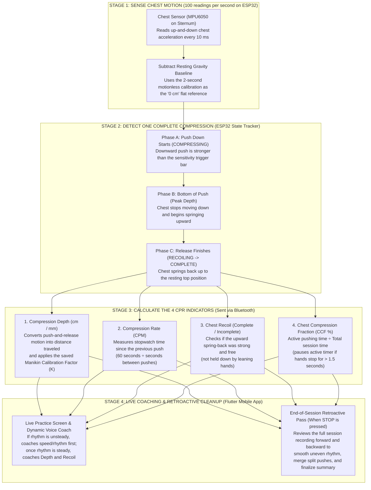
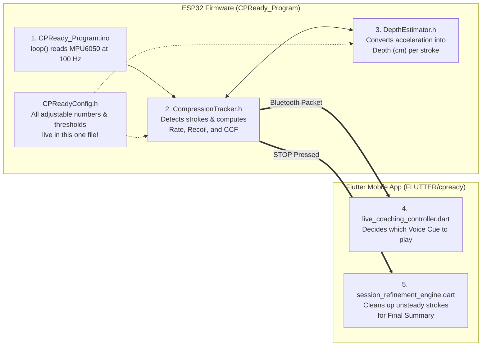

# CPReady Algorithm, Code Flow & Research Defense Guide

> **How to Use This Guide**
> This document is written specifically to help the research team prepare for both **manuscript writing (Chapters 3 & 5)** and the **oral research defense**.
> Every question below is answered in four parts:
> 1. **15-Second Defense Answer**: A short, direct answer you can say out loud first when a panelist asks the question.
> 2. **How It Works (In Plain English)**: A clear, step-by-step explanation using everyday concepts—no advanced math or signal-processing jargon required.
> 3. **Why We Designed It This Way (The Rationale)**: Why this specific approach was chosen and what practical problem it solves.
> 4. **Paper-Ready Text**: Formal academic phrasing you can adapt directly into your paper.

---

## Part 1: General Algorithm Overview & Flowchart

### How CPReady Turns Chest Pushes into CPR Readings (Big Picture)
At its core, CPReady works in **four continuous steps** split between the **ESP32 inside the vest** (which handles fast sensor readings 100 times per second) and the **Flutter mobile app** (which handles voice coaching, display, and end-of-session cleanup):

1. **Step 1 — Sense Movement (`100 times per second`)**: The MPU6050 sensor on the center of the chest reads how fast the chest is speeding up or slowing down, and subtracts the resting pull of gravity recorded during the 2-second calibration.
2. **Step 2 — Track One Complete Push (`3 Phases`)**: The ESP32 watches each push go through three natural physical stages: **Pushing Down** $\rightarrow$ **Reaching the Bottom** $\rightarrow$ **Springing Back Up (Release)**.
3. **Step 3 — Calculate the 4 CPR Indicators**: The instant the chest finishes springing back up, the ESP32 calculates **Depth**, **Rate (CPM)**, **Recoil**, and **Chest Compression Fraction (CCF %)** and sends them to the phone over Bluetooth.
4. **Step 4 — Smart Voice Coaching & End-of-Session Review**: During practice, the phone app coaches the trainee's rhythm and depth. When `STOP` is pressed, the app reviews the entire session's recording from start to finish to clean up any uneven rhythm transitions before showing the final score.

### General Algorithm Flowchart
*(Note for the Research Team: Feel free to redesign, re-color, or re-layout this flowchart in Canva, Draw.io, PowerPoint, or Figma to fit your manuscript's page layout or defense slides—just keep the 4 main stages and arrow flow the same!)*



---

## Part 2: Answers to Research Defense & Paper Questions (Q1–Q9)

---

### Question 1: How the single MPU converts movement into CPR measurements

#### 1. 15-Second Defense Answer
> *"An accelerometer cannot see distance directly like a ruler—it feels acceleration, or how fast the chest speeds up and slows down. For every push, the ESP32 converts that downward and upward acceleration into speed, and then converts speed over time into distance traveled in millimeters. Because the training manikin sits on a firm surface, a single sensor on the sternum captures the chest's full compression movement."*

#### 2. How It Works (In Plain English)
Think of how a **car's speedometer and odometer** work together:
- **Step 1 (Feeling the Push — Acceleration)**: When you press the gas pedal in a car, you feel pushed back into your seat—that is **acceleration** (how fast your speed is changing). The MPU6050 on the chest feels this exact same thing: it feels the chest **speeding up downward** when you push, **slowing to a stop** at the bottom of the push, and **springing back upward** when you release.
- **Step 2 (From Acceleration to Speed)**: By checking how strong that push is every `0.01 seconds` (`100 times per second`), the microcontroller adds up the changes to know **how fast the chest is moving** at every moment of the stroke.
- **Step 3 (From Speed to Distance / Depth)**: If you know how fast something is moving and for how many milliseconds it moved, you know **how far it traveled** ($\text{Distance} = \text{Speed} \times \text{Time}$). The highest point minus the lowest point of that stroke gives the **Compression Depth** in centimeters/millimeters.

#### 3. Why We Designed It This Way (The Rationale)
- **Why a single chest sensor instead of internal wires?** Built-in manikin sensors use internal optical lasers or mechanical potentiometers inside the chest cavity, which only work inside that specific manikin. Using a motion sensor on the sternum allows CPReady to be worn as an external vest/pad on top of a training manikin.
- **Why single-MPU works as well as dual-MPU on a training manikin**: During bench testing on the Laerdal Little Anne QC, the manikin rests on a hard floor or table, so its backplate does not sink. Testing showed that a single chest sensor is just as accurate (`1.21 mm` average error after session refinement) while cutting wire clutter and sensor communication errors in half.

#### 4. Paper-Ready Paragraph
> *"The CPReady system measures compression kinematics using a single chest-mounted 6-axis inertial measurement unit (MPU6050) sampled at 100 Hz (`10 ms` intervals). Because an accelerometer measures linear acceleration rather than absolute position, the microcontroller isolates the vertical sternal acceleration component relative to the calibrated gravity baseline and performs two-stage numerical integration over each isolated compression cycle. The first stage accumulates acceleration over time to derive instantaneous chest velocity, and the second stage accumulates velocity over the stroke duration to obtain peak-to-trough vertical displacement (compression depth)."*

---

### Question 2: How the algorithm detects and counts shallow compressions

#### 1. 15-Second Defense Answer
> *"Shallow compressions are gentler than normal pushes, so a fixed high trigger would miss them, while a fixed low trigger would accidentally count hand tremors and manikin spring bounces. We solved this using an auto-adjusting trigger—like auto-volume on a microphone—that automatically lowers its detection bar whenever deep pushes stop, combined with a low minimum-depth check (`2.5 mm`) and a minimum push-duration check (`0.19 seconds`) so every real shallow compression is counted while tiny vibrations are ignored."*

#### 2. How It Works (In Plain English)
Detecting shallow compressions (`3.0–4.8 cm`) is a balancing act between **being sensitive enough to feel gentle pushes** and **not being fooled by fake bumps**:
1. **The Problem with a Fixed Sensitivity Bar**:
   - When you push deeply (`5.5 cm`) on a Laerdal manikin and let go, the stiff metal spring inside the manikin snaps the chest back up and **bounces slightly at the top**.
   - If the sensor's trigger bar were kept permanently super-low all the time, that little spring bounce at the top of every deep push would be mistaken for a brand-new push—causing the device to count 2 compressions for every 1 real push!
   - On the other hand, if the trigger bar were kept permanently high to block that bounce, gentler **shallow compressions** wouldn't be strong enough to cross the bar and would be completely missed.
2. **Our Solution — The "Auto-Adjusting Trigger" + Two Safety Checks**:
   - **Rule 1: Auto-Adjusting Trigger Bar**: While a trainee is doing strong, deep compressions, the sensor raises its trigger bar slightly right after each push so it ignores the manikin's top spring bounce. However, if the trainee switches to gentler, shallower pushes (or if `0.65 seconds` pass without a strong push), the trigger bar **automatically drops back down to its lowest setting** so soft pushes are detected immediately.
   - **Rule 2: Low Minimum-Distance Check (`2.5 mm` raw movement)**: Once the push finishes, the code checks that the chest moved at least a few millimeters before counting it. Every true shallow compression (`3.0–4.9 cm`) easily passes this check, while tiny `1 mm` hand tremors are rejected.
   - **Rule 3: Minimum Push Time Check (`0.19 seconds`)**: A real human chest compression takes at least a fifth of a second to go down and back up. Quick accidental taps or vibrations shorter than `0.19 seconds` are ignored.

#### 3. Why We Designed It This Way (The Rationale)
- **Preventing Artificial Average-Depth Inflation**: Suppose a trainee performs 30 compressions—15 deep (`5.5 cm`) and 15 shallow (`3.8 cm`). The true average depth is **`4.65 cm`**. If the algorithm failed to detect those 15 shallow pushes and only recorded the 15 deep ones, the summary screen would falsely report an average depth of **`5.5 cm`**, making a poor session look perfect!
- By using an auto-adjusting trigger that catches gentle pushes without double-counting spring bounces, CPReady counts all 30 pushes so the shallow strokes properly bring down the session average to match the Laerdal manikin.

#### 4. Paper-Ready Paragraph
> *"To ensure reliable capture of shallow compressions (`< 5.0 cm`) without introducing false positives from post-recoil manikin spring oscillations, the detection engine employs an adaptive onset threshold paired with duration and displacement gates. During high-force compressions, the onset threshold scales proportionally with recent peak acceleration to reject post-release mechanical bounce. When compression force decreases or after `650 ms` without a high-force trigger, the threshold rapidly relaxes toward its baseline floor (`0.06g–0.08g`), immediately unmasking gentler downstrokes. Candidate strokes are subsequently validated against a minimum cycle duration (`190 ms`) and a low unscaled displacement floor (`0.25 cm`), ensuring that shallow compressions are accurately counted and reflected in the session's mean depth."*

---

### Question 3: Why irregular rhythm affects real-time accuracy

#### 1. 15-Second Defense Answer
> *"To stop sensor errors from piling up over a 2-minute session, our live algorithm resets its measurement window after every single push and assumes each push starts and ends cleanly from rest. When a trainee's rhythm is irregular—such as hesitating mid-push or suddenly changing speed—the chest is still moving when one measurement window ends and the next begins, which can temporarily skew the live reading for that transition stroke."*

#### 2. How It Works (In Plain English)
- **Why We Reset After Every Push**: If you try to calculate distance from an accelerometer continuously for 2 straight minutes without ever resetting, tiny sensor imperfections snowball into huge errors within a few seconds. To prevent this, CPReady **measures one compression at a time** and resets its zero-line at the end of every push.
- **What Happens During Steady Rhythm**: When you push at a steady rhythm (like following a metronome), every push looks like a neat, complete wave: it starts at the top, goes smoothly down, comes smoothly back up, and finishes at the top. The start and end points match cleanly.
- **What Happens During Irregular Rhythm**: When a trainee's rhythm is unsteady—for example:
  1. **Hesitating or "Double-Pumping"**: They push halfway down, hesitate, push the rest of the way down, and release.
  2. **Sudden Speed Changes**: They do a very fast push (`0.3 seconds`) immediately followed by a very slow, drawn-out push (`0.9 seconds`).
- Because the live screen has to show a depth reading **the exact instant a push finishes** (without knowing what the trainee's hands will do next), a mid-push hesitation can cause the live detector to either cut the measurement window slightly early or stretch it across the hesitation pause.

#### 3. Why We Designed It This Way (The Rationale)
- In real-time coaching, **zero delay** is essential—a trainee needs to see their live numbers update immediately on every push. Accepting that a sudden rhythm hiccup can cause a temporary 1-stroke wobble in live mode (while showing a *"Rhythm unsteady"* notice on screen and fixing it automatically when the session finishes) is much safer than delaying the live display by several seconds.

#### 4. Paper-Ready Paragraph
> *"Real-time depth estimation from a single accelerometer relies on a per-stroke closed-cycle assumption, wherein each compression window is bounded by consecutive release points and normalized so that average acceleration and average velocity over the cycle equal zero. Under steady, periodic cadence, each stroke begins and ends at a consistent velocity state, yielding high per-stroke accuracy. Under irregular cadence—such as mid-stroke hesitation, double-peaked downstrokes, or abrupt rate transitions—the boundary velocity between adjacent strokes becomes non-zero and the integration window length fluctuates, introducing temporary per-stroke variance in the causal real-time estimate."*

---

### Question 4: How retroactive analysis improves final session results

#### 1. 15-Second Defense Answer
> *"While the live screen can only see one push at a time as it happens, the mobile app records the entire session's 100 Hz sensor stream in memory. The instant the session ends, the app runs a 4-step retroactive review across the complete timeline—looking both forward and backward—to smooth unsteady transitions, merge any single push that was split into two, rebalance uneven stroke pairs, and recover any light push in long gaps."*

#### 2. How It Works (In Plain English)
Think of the difference between a **live referee making an instant call** versus **watching the full Instant Replay after the play ends**:
- During the session, the ESP32 has to judge each push on the fly without knowing what comes next.
- Meanwhile, the Flutter app quietly saves every raw sensor reading (`100 readings per second`) in the phone's memory.
- When `STOP` is pressed, [`SessionRefinementEngine.refineSession`](file:///C:/Users/reynq/OneDrive/Documents/CPReady/FLUTTER/cpready/lib/src/core/metrics/session_refinement_engine.dart) reviews the whole recording from start to finish in less than `0.1 seconds` using **four cleanup steps**:
  1. **Step 1 — Forward-and-Backward Smoothing on Unsteady Pushes**: Because the session is now finished, the app filters the movement waveform **forward from start to end, and then backward from end to start** (called *zero-phase smoothing*). It uses the session's steady pushes as a reference ruler to correct the depth of unsteady transition pushes without shifting their timing.
  2. **Step 2A — Stitching Split Pushes Back Together**: If a hesitant push got accidentally chopped into two tiny half-pushes whose combined time is just one normal stroke (`~0.5–0.6 seconds`), the app merges them back into **1 full compression** and recalculates the combined depth.
  3. **Step 2B — Rebalancing Uneven Neighboring Pushes**: Sometimes during unsteady rhythm, two real pushes happen, but the dividing line between them shifts early—making the first push look artificially tiny (`1.5 cm`) and the second push look artificially huge (`8.0 cm`). The app spots this pair and re-centers their depths while keeping the count at 2 strokes.
  4. **Step 3 & 4 — Gap Check & Outlier Trimming**: Finally, it checks any unusually long gaps (`> 0.72 seconds`) to recover any gentle push that was missed, and caps any remaining single-stroke transition spike so it stays within reason of the surrounding steady pushes.

#### 3. Why We Designed It This Way (The Rationale)
- In testing across all 10 Laerdal ground-truth sessions, this end-of-session review improved the **Session Average Depth error from `1.62 mm` down to `1.21 mm`** and improved the **Total Compression Count error from `1.20 strokes` down to `0.50 strokes`** (every single test session landed within `±1 compression` of the Laerdal manikin).
- Running this pass on the **phone app** (instead of the ESP32) takes advantage of the phone's fast processor and large memory without slowing down the vest's Bluetooth connection.

#### 4. Paper-Ready Paragraph
> *"Upon session termination (`STOP`), the Flutter companion application executes a four-stage non-causal retroactive refinement pass (`SessionRefinementEngine`) over the buffered 100 Hz session recording. First, a forward-backward zero-phase high-pass filter (`filtfilt`) self-calibrated against the session's steady compressions corrects boundary-velocity errors on unsteady strokes. Second, adjacent stroke pairs exhibiting sub-period intervals (`< 330 ms`) are evaluated against the session's median period to either merge true split-stroke fragments into a single re-integrated compression or rebalance boundary-shifted stroke pairs. Third, inter-stroke intervals exceeding `720 ms` are scanned to recover any sub-threshold shallow compressions. Finally, residual unsteady transition outliers are bounded relative to the local steady median before computing the final session summary."*

---

### Question 5: Calibration reference point, cross-trial consistency, and causes of discrepancies with the manikin

#### 1. 15-Second Defense Answer
> *"CPReady uses a two-part calibration: first, a 2-second motionless 'Zeroing' step before each session that records the resting pull of gravity as the 0 cm flat starting line; and second, a 15-second Manikin Calibration trial that saves a permanent stiffness multiplier ($K$) in the ESP32's memory so the vest matches the Laerdal manikin. Small 1–2 mm differences across trials mainly come from vest foam cushioning, slight shifts in hand placement on the hinged chest, and the Laerdal manikin's own 1–2 mm rounding tolerance."*

#### 2. How It Works & Rationale (In Plain English)

##### A. How the Reference Point Is Established (Why There Are Two Calibration Steps)
Every time you put the CPReady vest on a manikin, there are two physical things the sensor needs to learn: **(1) Which way is straight down?** and **(2) How much does the vest padding squish compared to the manikin's chest?**

1. **Calibration Step 1: The 2-Second Motionless "Zeroing" (`CALIBRATE` — Done Before Every Session)**
   - **What happens**: Before starting compressions, the trainee rests their hands still on the chest for 2 seconds (`200 readings`). The ESP32 checks that the chest is completely still, measures the steady pull of Earth's gravity (`~1.0 g`), and locks that exact force and tilt angle in as **"Zero Depth (`0.0 cm`)"**.
   - **Why we do this (Rationale)**: A sensor placed on a curved manikin chest is never perfectly level with the floor—it is always tilted by a few degrees. If the device didn't learn the exact resting tilt and gravity pull first, Earth's gravity would look like someone constantly pushing on the chest! Subtracting this 2-second baseline guarantees that `0.0 cm` is truly the resting top of the chest.

2. **Calibration Step 2: The 15-Second Manikin Matching Trial (`CALIBRATE_TARGET` — Done Once Per Manikin Setup)**
   - **What happens**: In the app's *Manikin Calibration* screen, the user performs 15 seconds of steady compressions on the manikin, looks at the average depth reported by the Laerdal QC app (for example, `5.4 cm`), and types `5.4` into the CPReady app. The ESP32 compares its own reading to `5.4 cm`, calculates a **Correction Multiplier (called the $K$ factor, default `10.85`)**, and saves it permanently into the ESP32's non-volatile flash memory (NVS).
   - **Why we do this (Rationale)**: The CPReady sensor sits *inside a padded vest pouch on top of the sternum*, whereas the Laerdal manikin's sensor sits *underneath the plastic chest plate*. When you push down, the vest fabric and EVA foam squish by a few millimeters, and the hinged chest plate bends at an angle. Saving the $K$ multiplier calibrates CPReady's "ruler" so its depth matches the manikin's internal ruler.

##### B. How We Keep Readings Consistent Across Multiple Trials
- **Permanent Flash Memory Storage**: The calibrated multiplier ($K$) is saved in the ESP32's permanent memory (`Preferences` / NVS), so it does not reset when the vest is turned off or the battery is changed.
- **Fresh Gravity Zeroing Every Session**: Running the 2-second motionless zeroing before each session automatically adjusts if the manikin was moved to a slightly tilted table or if the vest was re-strapped slightly differently.
- **Per-Push Resetting**: Because every single compression resets its speed and distance baseline back to zero at the end of the release, sensor drift never builds up from Trial 1 to Trial 10.

##### C. What Causes Small (`1–2 mm`) Discrepancies Between CPReady and the Manikin
Even after calibration, you may see a `1–2 mm` difference between CPReady and the Laerdal QC screen on some trials. This happens for three physical reasons:
1. **EVA Foam & Pouch Cushioning**: Soft pushes and very hard pushes compress the vest's foam padding by slightly different amounts (`~1–2 mm` variation).
2. **Hand Placement on a Hinged Chest**: The Laerdal Little Anne chest plate is attached to a hinge (like a stiff door). Placing your hands just `1–2 cm` higher or lower on the sternum changes how far the top of the chest travels compared to the manikin's internal sensor point.
3. **Laerdal Manikin Display Rounding**: The Laerdal Little Anne QC app rounds its session average to whole millimeters (`54 mm`, `55 mm`) and has its own internal sensor tolerance of `±1–2 mm`.

#### 4. Paper-Ready Paragraph
> *"Reference establishment in CPReady follows a two-stage calibration protocol. Prior to each session, a 2-second (`200-sample`) motionless baseline calibration (`CALIBRATE`) captures the static 3-axis gravity vector and verifies sensor stability, defining the resting chest plane (`0.0 cm`) and isolating the vertical compression axis regardless of torso tilt. To account for mechanical compliance between the external vest padding and the manikin's internal sternum mechanism, a 15-second reference trial (`CALIBRATE_TARGET`) scales the kinematic depth constant ($K$, default `10.85`) against the reference manikin's reported mean depth and stores this factor in non-volatile flash memory (NVS). Minor inter-trial discrepancies (`1–2 mm`) arise primarily from non-linear compression of the EVA foam housing, variations in hand placement along the hinged sternal plate, and the `±1–2 mm` integer quantization of the reference manikin."*

---

### Question 6: How the algorithm determines Compression Rate, Recoil, and Chest Compression Fraction (CCF)

#### 1. 15-Second Defense Answer
> *"Rate is calculated like a stopwatch by measuring the exact time in milliseconds between consecutive compressions and dividing 60 seconds by that time gap. Recoil is determined by checking whether the upward spring-back acceleration during chest release is strong enough (`at least 0.35g upward`), which drops if the trainee leans on the chest. CCF is calculated using two timers: Active Pushing Time divided by Total Session Time, where the active timer automatically pauses whenever more than 1.5 seconds pass without a compression."*

#### 2. How Each Indicator Is Calculated (Step by Step)

| Indicator | Specific Sensor Data & Conditions Used | How the Value Is Calculated (Plain English) |
| :--- | :--- | :--- |
| **1. Compression Rate (`rate_cpm`)** | - **Data used**: Timestamp (`currentMillis`) when each compression finishes.<br>- **Conditions**: Time gap between strokes must be between **`300 ms` (`0.3 s`)** and **`1500 ms` (`1.5 s`)** (equivalent to `40–200 CPM`). The very first stroke after a pause has no rate yet because you need two strokes to measure a gap. | **Live Rate**: Measures the time gap since the previous push ($\Delta t$ in milliseconds) and computes $\text{Rate} = 60,000 \div \Delta t$, smoothed over the last 4 pushes so the number on screen doesn't jump wildly.<br>**Final Summary Rate**: Uses the average time gap across all valid pushes in the session. |
| **2. Chest Recoil (`recoil_complete` / `%`)** | - **Data used**: Upward rebound acceleration (`troughAccel`) measured during the release phase (`RECOILING`).<br>- **Condition**: Upward spring-back force must reach at least **`-0.35 g`** (`recoilCompleteThresholdG`). | When you release the chest cleanly, the manikin's spring snaps the chest upward briskly (creating a strong upward reading stronger than `-0.35 g` $\rightarrow$ **Complete Recoil = Yes / 100%**). If you lean your body weight on the chest at the top, the chest rises slowly and sluggishly (weaker than `-0.35 g` $\rightarrow$ **Incomplete Recoil = No / 0%**). The session summary reports the **percentage of total pushes** that had complete recoil. |
| **3. Chest Compression Fraction (`ccf_percent`)** | - **Data used**: First compression onset timestamp (`firstCompressionStartMillis`), cumulative active compression time (`totalActiveCompressionMillis`), and session end timestamp (`endMillis`).<br>- **Conditions**: Starts counting on the **very first compression** (matching the Laerdal manikin). Hands-off pause threshold is **`1500 ms` (`1.5 s`)**, with each continuous stroke capped at **`1000 ms` (`1.0 s`)** of active credit. | Runs two stopwatches starting from Push #1:<br>1. **Active Resuscitation Time**: Starts on the first push (so waiting on *"Start When Ready"* before pushing never penalizes you) and runs non-stop until `STOP`.<br>2. **Active Compression Time**: Credits `550 ms` for the initial/post-pause push plus every continuous push (`<= 1.5 s`, capped at `1.0 s`), and **pauses automatically** whenever more than `1.5 seconds` pass without a push.<br>**Formula**: $\text{CCF \%} = (\text{Active Compression Time} \div \text{Active Resuscitation Time}) \times 100$. |

#### 3. Paper-Ready Paragraph
> *"Compression rate, chest recoil, and Chest Compression Fraction (CCF) are derived from stroke timing and release kinematics on the ESP32. Instantaneous compression rate (in CPM) is computed from the inter-stroke interval $\Delta t$ (in milliseconds) between successive stroke completions ($60,000 / \Delta t$) for intervals within `300–1500 ms` (`40–200 CPM`), smoothed over a 4-stroke rolling window for live display. Chest recoil completion is evaluated during the upward release phase by comparing peak upward rebound acceleration against an empirical release threshold (`-0.35 g`); strokes failing to reach this rebound velocity due to residual rescuer leaning are flagged as incomplete, and the session summary reports the percentage of strokes achieving full release. CCF is computed from the first detected compression as the ratio of cumulative active compression time to total elapsed session time, where active time accrual pauses whenever the inter-stroke interval exceeds the `1.5 s` hands-off pause threshold."*

---

### Question 7: Actual effect of the three sensitivity modes (`HIGH`, `BALANCED`, `STRICT`)

#### 1. 15-Second Defense Answer
> *"The three sensitivity modes only change the detection gatekeepers—meaning how easily a push is triggered and counted as a stroke—and do NOT change the depth measurement ruler itself. A steady 5.5 cm push still measures 5.5 cm in all three modes; the modes simply let researchers adjust how sensitive the vest is to very light pushes versus accidental hand bumps."*

#### 2. Do They Affect Detection Thresholds, Movement Processing, or Both?
- **They affect the Detection Thresholds (the "Gatekeepers"), NOT the Depth Ruler**:
  - Once a stroke is accepted, the math that turns movement into centimeters (`closedCycleDepthCm` and the $K$ calibration factor) is **100% identical** across `HIGH`, `BALANCED`, and `STRICT`.
  - What changes are the **four gatekeeper numbers** that decide *"Was that movement a real compression, or just a hand bump?"*

| Setting / Gatekeeper | `HIGH` Mode (Most Sensitive) | `BALANCED` Mode (Default) | `STRICT` Mode (Most Filtering) | Plain-English Meaning |
| :--- | :---: | :---: | :---: | :--- |
| **1. Downward Push Trigger** | `0.06 g` | **`0.08 g`** | `0.12 g` | How hard you must push down to start a stroke. |
| **2. Auto-Adjusting Bounce Guard** | `25%` of peak | **`30%` of peak** | `40%` of peak | How strongly the trigger rises after deep pushes to block spring bounce. |
| **3. Upward Release Arming** | `20%` of push (`min 0.03g`) | **`15%` of push (`min 0.04g`)** | `25%` of push (`min 0.07g`) | How much upward rebound is needed to finish counting the stroke. |
| **4. Minimum Depth to Count** | `2.5 mm` raw | **`2.5 mm` raw** | `5.0 mm` raw | Smallest movement allowed to count as 1 compression. |

#### 3. Why We Have Three Modes (When to Use Each)
- **`BALANCED` (Recommended Default)**: Tuned specifically for standard CPR sessions on the Laerdal Little Anne QC—catches shallow compressions while blocking post-release spring bounce.
- **`HIGH`**: Useful when testing intentionally very light/shallow compressions (`~3.0–3.5 cm`) or when using a heavily damped foam manikin that doesn't spring back sharply.
- **`STRICT`**: Useful if the manikin is on a slightly shaky table or if trainees tend to tap/reposition their hands heavily during pauses and you want to strictly ignore hand bumps.

#### 4. Paper-Ready Paragraph
> *"The three selectable sensitivity presets (`HIGH`, `BALANCED`, and `STRICT`) configure the state-machine detection thresholds governing stroke onset and completion without altering the underlying kinematic depth integration scale. Specifically, the presets adjust four gatekeeper parameters: the minimum downward onset acceleration floor (`0.06g`, `0.08g`, and `0.12g`), the adaptive envelope scaling fraction (`0.25`, `0.30`, and `0.40`), the upward recoil arming fraction, and the minimum unscaled stroke displacement gate (`0.25 cm` for `HIGH`/`BALANCED` and `0.50 cm` for `STRICT`). Consequently, steady compressions produce identical depth readings across all three modes, while researchers can tune false-positive rejection versus shallow-stroke sensitivity for different training environments."*

---

### Question 8: Other conditions or factors that could affect single-MPU accuracy

#### 1. 15-Second Defense Answer
> *"Aside from irregular rhythm, four physical factors can affect a single-MPU setup: (1) placing the manikin on a soft mattress instead of a hard floor, because the single sensor feels both the chest and the mattress sinking; (2) pushing off-center at an angle, which tilts the sensor mid-stroke; (3) loose vest straps that let the sensor pouch bounce; and (4) moving hands during the 2-second calibration step."*

#### 2. The 4 Real-World Factors & How Your Testing Protocol Controls Them

| Factor | Why It Affects a Single Chest MPU | How We Control / Prevent It in Testing |
| :--- | :--- | :--- |
| **1. Soft Surface Underneath the Manikin ("Mattress Effect")** | A single sensor on the sternum measures how far the chest moves down **relative to the floor**. If the manikin is placed on a soft bed or cushion, pushing down compresses *both* the chest (`5 cm`) *and* the mattress (`2 cm`), making the depth read too high (`7 cm`). | Place the training manikin on a **hard, rigid floor or solid workbench** during all trials (standard BLS training posture). |
| **2. Off-Center Pushing / Chest Rocking** | During forceful CPR, if a trainee pushes toward the side of the sternum instead of straight down, the sensor tilts slightly (`3°–5°`) mid-push. Because the accelerometer has no gyroscope turned on, a sudden tilt slightly alters how much gravity it feels (`~1–2 mm` effect). | Keep hands centered on the sternum pouch using standard interlocked-finger CPR hand placement. |
| **3. Loose Vest Straps or Shifting Sensor Pouch** | If the vest is strapped loosely, lifting the hands at the top of a stroke allows the fabric pouch to lift or slap against the chest independently of the manikin's plastic sternum plate. | Fasten the vest snugly flat against the manikin torso before calibrating. |
| **4. Movement During the 2-Second Zeroing Step** | If the trainee is already pressing or wiggling the chest during the 2-second `CALIBRATING` screen, the "0 cm" gravity baseline could be recorded slightly crooked. | The firmware includes a **Stability Check** (`ERR_MOTION_UNSTABLE`) that rejects calibration and asks the user to retry if the chest moves during those 2 seconds. |

#### 3. Paper-Ready Paragraph
> *"Beyond cadence irregularity, four physical factors bound the accuracy of a single-IMU sternal configuration: (1) underlying support surface compliance, as a single chest accelerometer measures total vertical displacement relative to the inertial room frame and would include mattress deflection if operated on a soft bed; (2) dynamic sternal tilt during off-axis compressions, where angular rocking introduces a minor gravity-projection error (`~0.5–1.5 mm`); (3) mechanical coupling of the vest enclosure, requiring snug strap tension so the sensor housing tracks the sternum without parasitic bounce; and (4) baseline stillness during the 2-second zeroing phase, which is enforced in firmware via a variance rejection guard."*

---

### Question 9: Basic Code Flow Walkthrough & Minor Troubleshooting Cheat Sheet

#### 1. High-Level Code Map (Which File Does What?)
You only need to know **3 files on the ESP32** and **2 files on the Flutter App** to understand or troubleshoot the entire CPR calculation pipeline:



---

#### 2. Function-by-Function Walkthrough for Each CPR Indicator

##### A. Where Every Sensor Reading Starts (`100 times per second`)
- **File**: [`CPReady_Program/CPReady_Program.ino`](file:///c:/Users/reynq/OneDrive/Documents/CPReady/CPReady_Program/CPReady_Program.ino) $\rightarrow$ **`loop()`**
  - Every `10 milliseconds` (`100 Hz`), `loop()` reads the chest accelerometer (`mpu1`), calls **`compressionTracker.update(...)`**, and sends the latest readings over Bluetooth via **`bleManager.notifyReading(...)`**.

##### B. How **Compression Depth** Is Calculated in Code
1. **`CompressionTracker::processSample(...)`** (in [`CompressionTracker.h`](file:///c:/Users/reynq/OneDrive/Documents/CPReady/CPReady_Program/include/CompressionTracker.h)):
   - Takes the raw X, Y, Z sensor readings and subtracts the calibrated resting gravity (`computeProjectedAccelG`) to get **`netAccel`** (pure downward/upward push force).
   - Feeds every 10 ms reading into **`depthEstimator.push(netAccel, dtSeconds)`**.
2. **`DepthEstimator::closedCycleDepthCm(...)`** (in [`DepthEstimator.h`](file:///c:/Users/reynq/OneDrive/Documents/CPReady/CPReady_Program/include/DepthEstimator.h)):
   - Called the exact moment a push finishes (`state == StrokeState::RECOILING` and the chest returns to rest).
   - Loops through the saved samples of that push:
     - **Loop 1**: Finds the average acceleration (`meanA`) and subtracts it so any constant tilt is canceled out.
     - **Loop 2**: Adds up acceleration over time (`v += a * dt`) to get **velocity (speed)**, and finds the average speed (`meanV`).
     - **Loop 3**: Adds up speed over time (`x += (v - meanV) * dt`) to get **position (`x`)**, and returns `maxX - minX` (the raw distance traveled in cm).
3. **Applying the Calibration Multiplier ($K$)**:
   - Back in `CompressionTracker::processSample(...)`, it multiplies that raw distance by the saved Manikin Calibration Factor:
     ```cpp
     float scaledDepthCm = physicalDepthCm * (depthScaleFactor / CPReadyConfig::DEFAULT_DEPTH_SCALE);
     ```
   - Saves `currentDepthCm = scaledDepthCm` and adds it to `sumCompressionDepthCm` for the session average!

##### C. How **Compression Rate (CPM)** Is Calculated in Code
- **File**: [`CompressionTracker.h`](file:///c:/Users/reynq/OneDrive/Documents/CPReady/CPReady_Program/include/CompressionTracker.h) $\rightarrow$ inside **`processSample(...)`** and **`calculateRollingRate()`**:
  1. When a push finishes, it subtracts the timestamp of the previous push from the current time:
     ```cpp
     uint32_t rawPeriodMs = currentMillis - lastStrokePeakMillis;
     ```
  2. As long as `rawPeriodMs` is between `300 ms` and `1500 ms` (a real rhythm between `40` and `200 CPM`), it converts milliseconds into Compressions Per Minute:
     ```cpp
     float instantRate = 60000.0f / (float)rawPeriodMs;
     ```
  3. **`calculateRollingRate()`** averages the last 4 strokes in `rateHistory[]` so the live number on screen is smooth, and **`getFinalSummaryReadings()`** averages all valid stroke intervals (`sumValidStrokePeriodsMs`) for the final score.

##### D. How **Chest Recoil** Is Calculated in Code
- **File**: [`CompressionTracker.h`](file:///c:/Users/reynq/OneDrive/Documents/CPReady/CPReady_Program/include/CompressionTracker.h) $\rightarrow$ inside **`processSample(...)`**:
  1. While the chest is springing back up (`StrokeState::RECOILING`), the code tracks the strongest upward rebound reading in **`troughAccel`**.
  2. When the push finishes, it checks if that upward rebound was stronger than the complete-recoil threshold (`recoilCompleteThresholdG = -0.35g`):
     ```cpp
     lastStrokeRecoilComplete = (troughAccel < activeTriggers.recoilCompleteThresholdG);
     if (lastStrokeRecoilComplete) {
         goodRecoilStrokeCount++;
     }
     ```
  3. At the end of the session, **`getFinalSummaryReadings()`** calculates the session recoil percentage:
     ```cpp
     (goodRecoilStrokeCount * 100) / totalStrokeCount;
     ```

##### E. How **Chest Compression Fraction (CCF %)** Is Calculated in Code
- **File**: [`CompressionTracker.h`](file:///c:/Users/reynq/OneDrive/Documents/CPReady/CPReady_Program/include/CompressionTracker.h) $\rightarrow$ inside **`processSample(...)`** and **`finalizeSession(...)`**:
  1. **Active Resuscitation Clock (`firstCompressionStartMillis`)**: Starts on the very first compression (crediting `NOMINAL_FIRST_STROKE_ACTIVE_MS = 550 ms`), matching the Laerdal manikin so pre-session waiting time on the *"Start When Ready"* screen never lowers CCF.
  2. **Accruing Active Time (`totalActiveCompressionMillis`)**: Every continuous stroke (`rawPeriodMs <= 1500 ms`, including sub-300 ms bounce fragments) adds `min(rawPeriodMs, 1000)` to `totalActiveCompressionMillis`. If the trainee pauses for `> 1.5 seconds` (`PAUSE_DETECTION_TIMEOUT_MS`), the pause gap is not added while the resuscitation clock (`endMillis - firstCompressionStartMillis`) keeps ticking.
  3. **Session Summary (`finalizeSession`)**: Computes:
     ```cpp
     s.final_ccf_percent = min(100.0f, ((float)totalActiveCompressionMillis / (float)activeSessionMs) * 100.0f);
     ```

##### F. Where the End-of-Session Retroactive Pass & Voice Coach Run (Flutter App)
- **Retroactive Refinement**: [`FLUTTER/cpready/lib/src/core/metrics/session_refinement_engine.dart`](file:///C:/Users/reynq/OneDrive/Documents/CPReady/FLUTTER/cpready/lib/src/core/metrics/session_refinement_engine.dart) $\rightarrow$ **`SessionRefinementEngine.refineSession(...)`** (called automatically inside [`live_practice_screen.dart`](file:///C:/Users/reynq/OneDrive/Documents/CPReady/FLUTTER/cpready/lib/src/screens/live_practice/live_practice_screen.dart) inside `_finish()` when `STOP` is pressed).
- **Voice Coaching Logic**: [`FLUTTER/cpready/lib/src/core/audio/live_coaching_controller.dart`](file:///C:/Users/reynq/OneDrive/Documents/CPReady/FLUTTER/cpready/lib/src/core/audio/live_coaching_controller.dart) $\rightarrow$ **`LiveCoachingController.evaluate(...)`** (checks each stroke's depth, rate, and recoil, and suppresses depth prompts while rhythm is unsteady).

---

#### 3. Minor Troubleshooting Cheat Sheet (Quick Adjustments Without Rewriting Code)
If you ever need to make a small adjustment during testing or before defense, almost every tunable number is in [`CPReady_Program/include/CPReadyConfig.h`](file:///c:/Users/reynq/OneDrive/Documents/CPReady/CPReady_Program/include/CPReadyConfig.h) (or right inside the mobile app's Settings screen!):

| If You Notice This Issue... | Quickest Fix (No Reflashing Needed) | Where to Adjust in Code (If Reflashing ESP32 / App) |
| :--- | :--- | :--- |
| **Depth readings are consistently `2–4 mm` higher or lower than the manikin** | Open the App $\rightarrow$ **Manikin Calibration** (run 15s trial) or **Device Settings** $\rightarrow$ adjust **K Factor** (`+0.20` on $K$ raises depth by `~1 mm`). | [`CPReadyConfig.h`](file:///c:/Users/reynq/OneDrive/Documents/CPReady/CPReady_Program/include/CPReadyConfig.h): Change `DEFAULT_MANIKIN_DEPTH_SCALE` (currently `10.85f`). |
| **Very gentle/shallow pushes (`~3.0 cm`) are not being counted** | Open the App $\rightarrow$ switch Sensitivity Mode to **`HIGH`**. | [`CPReadyConfig.h`](file:///c:/Users/reynq/OneDrive/Documents/CPReady/CPReady_Program/include/CPReadyConfig.h): Lower `MIN_START_THRESHOLD_G` (from `0.08f` to `0.06f`) or `MIN_STROKE_DEPTH_CM` (from `0.25f` to `0.20f`). |
| **Extra false compressions are counted when hands bump the chest** | Open the App $\rightarrow$ switch Sensitivity Mode to **`STRICT`**. | [`CPReadyConfig.h`](file:///c:/Users/reynq/OneDrive/Documents/CPReady/CPReady_Program/include/CPReadyConfig.h): Raise `MIN_START_THRESHOLD_G` (from `0.08f` to `0.11f`) or `MIN_STROKE_DEPTH_CM` (to `0.40f`). |
| **Recoil % is too strict (marks good releases as incomplete)** | — | [`CPReadyConfig.h`](file:///c:/Users/reynq/OneDrive/Documents/CPReady/CPReady_Program/include/CPReadyConfig.h): Make `RECOIL_COMPLETE_ACCEL_G` closer to zero (e.g., change `-0.35f` to `-0.25f`). |
| **CCF % drops too quickly during brief pauses** | — | [`CPReadyConfig.h`](file:///c:/Users/reynq/OneDrive/Documents/CPReady/CPReady_Program/include/CPReadyConfig.h): Increase `PAUSE_THRESHOLD_MS` from `1500` (`1.5 s`) to `2000` (`2.0 s`). |
| **Voice Coach speaks too frequently or not frequently enough** | Tap the **Mute Speaker icon** on the Live Practice header to silence cues during a test. | [`live_coaching_controller.dart`](file:///C:/Users/reynq/OneDrive/Documents/CPReady/FLUTTER/cpready/lib/src/core/audio/live_coaching_controller.dart): Change `consecutiveErrorStrokes` (`5`) or `promptCooldownMs` (`5000` ms = 5 seconds). |

---

## Part 3: Recommendations for Future Researchers (For Chapter 5 of the Manuscript)

Below are **four concrete, well-justified recommendations** that you can include directly in the **Recommendations / Future Work** section of your paper and slides. Each recommendation includes the **technical reason why it is recommended** based on what we observed while building CPReady.

---

### Recommendation 1: Integrate a Thin Force-Sensitive Resistor (FSR) or Contact Switch Beneath the Palm Pad
- **What to Recommend**: Add a paper-thin pressure sensor (Force-Sensitive Resistor) or mechanical contact switch inside the chest compression pad directly beneath the rescuer's palm.
- **Why It Is Recommended (1–2 Sentence Rationale)**: An accelerometer can only sense *movement* (changes in speed), which means it cannot directly tell the difference between a trainee resting their hands lightly on the chest versus leaning `5 kg` of body weight on the sternum at a standstill. Adding a thin pressure sensor solves both problems at once: it directly measures residual leaning force for **true Chest Recoil detection**, and it gives the microcontroller an exact physical "push started / push ended" switch that eliminates rhythm-boundary errors during erratic compressions.
- **Paper-Ready Text**:
  > *"Future iterations of the CPReady hardware should integrate a low-profile Force-Sensitive Resistor (FSR) or contact switch within the sternal compression pad. Because an accelerometer measures only kinematic acceleration and cannot directly observe static downward force at rest, incorporating a contact-pressure sensor will enable direct measurement of incomplete chest release (leaning force) and provide an exact mechanical zero-velocity boundary marker at the start and end of each compression."*

---

### Recommendation 2: Utilize a Dual-Sensor Differential Setup When Operating on Soft Surfaces (Hospital Mattresses)
- **What to Recommend**: While a single chest MPU is ideal for standard floor-based manikin training, re-enable a second reference sensor (`MPU2`) placed underneath the manikin backplate or on the bed frame when training on soft hospital beds.
- **Why It Is Recommended (1–2 Sentence Rationale)**: During floor-based training on the Laerdal Little Anne QC, the back of the manikin cannot move downward, making a second sensor redundant. However, in in-hospital resuscitation simulations performed on a foam mattress, pushing on the chest compresses both the patient's sternum and the mattress underneath; a second sensor on the backplate allows the system to subtract the mattress sinking distance so only true chest compression depth is reported.
- **Paper-Ready Text**:
  > *"While a single sternal IMU provides optimal reliability and accuracy on rigid training surfaces, future studies evaluating CPR performance on compliant hospital mattresses should employ a second reference accelerometer mounted on the manikin backplate. Subtracting the vertical acceleration of the support surface from the sternal sensor in real time will prevent mattress deflection from inflating measured compression depth."*

---

### Recommendation 3: Upgrade Sensor Communication to High-Speed SPI (`200–400 Hz`) with 6-Axis Gyroscope Tilt Compensation
- **What to Recommend**: Upgrade the accelerometer connection from standard I2C (`100 Hz`) to a high-speed SPI IMU (such as the `ICM-42688-P` or `BMI270` running at `200–400 Hz`) and fuse the built-in 3-axis gyroscope.
- **Why It Is Recommended (1–2 Sentence Rationale)**: Forceful chest compressions on a hinged manikin torso cause the sternum plate to rock slightly (`3°–5°`) during each push, and standard I2C wiring can occasionally experience brief timing jitter if the wires are flexed repeatedly. Sampling at `200–400 Hz` over SPI while using the gyroscope to continuously track the exact tilt angle of the chest mid-push will eliminate tilt-related depth drift and make the hardware immune to wire-flex communication pauses.
- **Paper-Ready Text**:
  > *"Future hardware revisions should transition from a 100 Hz I2C accelerometer to a 200–400 Hz SPI 6-axis inertial measurement unit with continuous gyroscope-accelerometer sensor fusion. Tracking dynamic sternal tilt angles (`3°–5°`) throughout each compression stroke will eliminate gravity-projection errors during off-axis pushing while providing higher temporal resolution for stroke boundary detection."*

---

### Recommendation 4: Expand Multi-Manikin Calibration Profiles (Adult, Child, and Infant Presets) and Optical Reference Benchmarking
- **What to Recommend**: Build a library of selectable manikin presets in the mobile app (e.g., *Laerdal Little Anne*, *Resusci Anne*, *Pediatric/Infant Manikin*) and benchmark per-stroke waveforms against a linear draw-wire or optical distance encoder.
- **Why It Is Recommended (1–2 Sentence Rationale)**: The current study validated CPReady against a single adult Laerdal Little Anne QC manikin, which only displays whole-session averages rounded to the nearest millimeter rather than individual stroke depths. Testing across multiple manikin stiffnesses and recording a continuous millimeter-accurate optical or draw-wire position sensor alongside the vest will allow future researchers to validate accuracy on every individual stroke across adult, child, and infant CPR protocols.
- **Paper-Ready Text**:
  > *"Because the present evaluation was conducted on a single adult Laerdal Little Anne QC manikin that exports only session-level summary metrics, future researchers should validate the device across multiple manikin models (including pediatric and infant compliances) and instrument the test rig with a continuous linear potentiometer or optical draw-wire encoder. Capturing ground-truth displacement per stroke will enable granular waveform validation and support pre-configured calibration profiles in the mobile application."*
