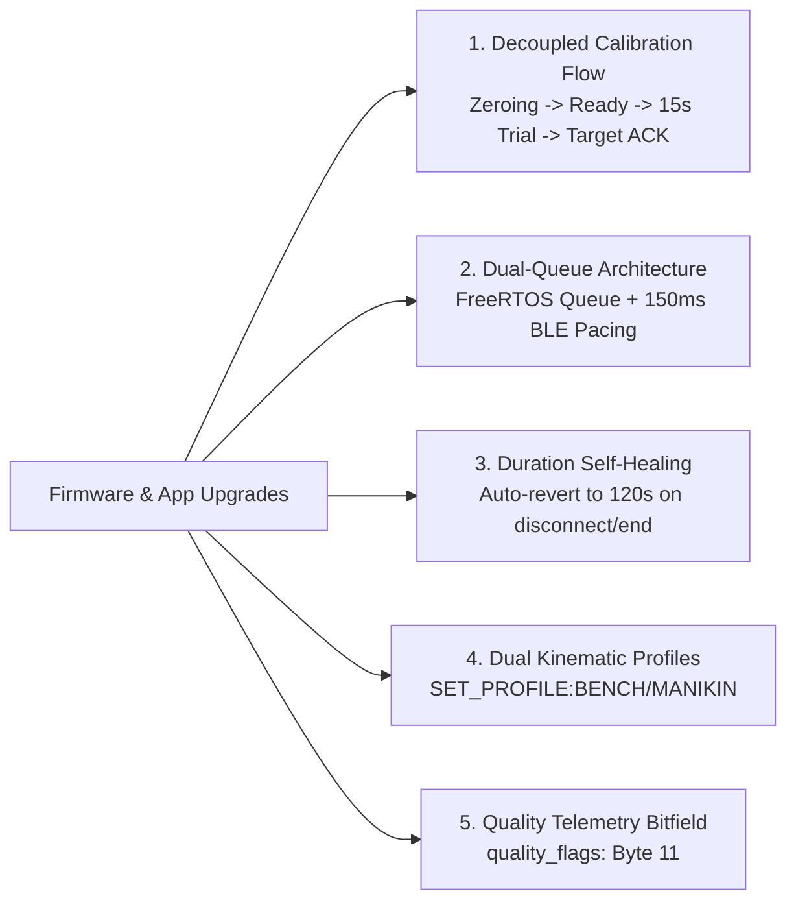

# CPReady: Recent Firmware Features & Mobile UI Flow Guide

**Target Audience**: Mobile Application Developers (Flutter), UI/UX Designers, and QA Testers  
**Hardware Platform**: ESP32 Dev Module (Dual MPU6050 Motion Engine)  
**Document Purpose**: Implementation specification for newly added firmware features, detailing exact UI screens, user journeys, interaction diagrams, and BLE command protocols needed in the mobile app.

---

## 1. Executive Summary: What Changed in Firmware & Architecture

The CPReady firmware and mobile application have recently been upgraded with five major feature and resilience subsystems:

1. **1-Step Manikin Depth Calibration**: The ESP32 auto-calculates and persists its harmonic depth constant $K$ directly into flash NVS when provided with a target ground-truth depth from the manikin, responding with a Packet Type 3 confirmation ACK.
2. **Dual-Queue Command Architecture**:
   - **ESP32 Firmware**: An 8-slot FreeRTOS FIFO queue (`commandQueue`) absorbs rapid command bursts from BLE ISR callbacks without dropping packets.
   - **Flutter App**: A sequential command queue in `BleController` enforces a **150ms safety pacing delay** between consecutive GATT characteristic writes, preventing Android/iOS GATT Error 133 / 22 link drops.
3. **Session Duration Self-Healing**: To prevent 15-second calibration runs from corrupting subsequent standard practice runs, `practiceDurationSec` automatically self-heals to `DEFAULT_PRACTICE_DURATION_SEC` (120s) upon session finalization, `STOP`, disconnect, or abort.
4. **Decoupled Multi-Step Calibration Flow**: Motionless baseline zeroing is completely separated from active compression execution. The user verifies resting baseline first, gets in position, and explicitly initiates the 15-second trial run.
5. **Dual Kinematic Profiles & 12-Byte Telemetry**:
   - Runtime switching between **Adult Manikin Mode** (0.45g start, -0.35g recoil, $K=11.2$) and **Bench Test Mode** (0.25g start, -0.18g recoil, $K=9.5$).
   - 12-byte telemetry packet with `quality_flags` (Byte 11) for cadence stability, first-stroke period bounding, and active profile detection.



---

## 2. Screen 1: Decoupled Manikin Calibration Flow & Screen

### 2.1 The Problem It Solves
Different CPR manikins (e.g., Laerdal Little Anne, Prestan Professional) have varying chest spring stiffnesses and mechanical travel. The instructor needs a simple, guided workflow to calibrate the vest to match the manikin's built-in mechanical clicker or reference sensor.

Previously, attempting to send `SET_TIME:15` immediately followed by `CALIBRATE` with 0ms delay overwhelmed the BLE stack (GATT 133/22 disconnects) and silently dropped the second command in firmware. Furthermore, running zeroing and compressions in a single rushed screen caused high sensor movement errors.

### 2.2 Decoupled 5-Stage Interaction Flow

```
[ Stage 1: Intro & Preparation ]
      │
      │ User taps "Zero Baseline"
      ▼
[ Stage 2: Motionless Zeroing ] ────(SET_TIME:15 + CALIBRATE via 150ms Queue)
      │                              Vest captures 2.0s resting gravity baseline
      ▼
[ Stage 3: Baseline Ready! ] ───────(Packet Type 3: CALIBRATED_READY received)
      │                              "Baseline Calibrated! Position hands over sternum."
      │ User taps "Begin 15s Trial"
      ▼
[ Stage 4: 15-Second Compression Trial ] ──(START command sent)
      │                                     Vest streams live metrics, auto-stops at 15s
      ▼
[ Stage 5: Reference Depth Entry ] ──(Packet Type 4: Summary received)
      │                               Displays vest mean depth (e.g. 4.40 cm)
      │ User enters manikin depth (e.g. 5.2 cm) and taps "Save Calibration"
      ▼
[ Stage 6: Confirmed Saved ] ────────(CALIBRATE_TARGET:5.2 -> Packet Type 3 ACK)
                                     K_new persisted to Flash NVS; Success displayed!
```

### 2.3 Proposed UI Wireframes & Layouts

#### Stage 1: Intro & Guidelines
```
+-------------------------------------------------------+
|  <- Back              Manikin Calibration             |
+-------------------------------------------------------+
|                                                       |
|  [ Instructions ]                                     |
|  1. Lay the CPReady vest flat on the manikin chest.   |
|  2. Rest your hands lightly on the sensor piece.      |
|  3. Tap "Zero Baseline" and keep hands still for 2s.  |
|                                                       |
|               +-----------------------+               |
|               |       STEP 1 / 3      |               |
|               |    SENSOR ZEROING     |               |
|               +-----------------------+               |
|                                                       |
|               [    ZERO BASELINE    ]                 |
|                                                       |
+-------------------------------------------------------+
```

#### Stage 2: Motionless Zeroing (2.0s)
```
+-------------------------------------------------------+
|  <- Back              Manikin Calibration             |
+-------------------------------------------------------+
|                                                       |
|                 Calibrating Baseline...               |
|        Keep hands completely still on the sensor.     |
|                                                       |
|               +-----------------------+               |
|               |         2 s           |               |
|               |   ZEROING SENSORS     |               |
|               +-----------------------+               |
|                                                       |
|               [  Zeroing in progress...  ] (Disabled) |
|                                                       |
+-------------------------------------------------------+
```

#### Stage 3: Baseline Ready Confirmation
```
+-------------------------------------------------------+
|  <- Back              Manikin Calibration             |
+-------------------------------------------------------+
|                                                       |
|  ✓ Baseline Calibrated!                               |
|  Position your hands over the sternum and prepare     |
|  to compress to the manikin clicker depth.            |
|                                                       |
|               +-----------------------+               |
|               |         15 s          |               |
|               |    TRIAL DURATION     |               |
|               +-----------------------+               |
|                                                       |
|               [   BEGIN 15s TRIAL   ]                 |
|                                                       |
+-------------------------------------------------------+
```

#### Stage 4: 15-Second Compression Trial Run
```
+-------------------------------------------------------+
|  <- Back              Manikin Calibration             |
+-------------------------------------------------------+
|                                                       |
|                   Compressing to Clicker...           |
|                                                       |
|               +-----------------------+               |
|               |         11 s          |               |
|               |    TIME REMAINING     |               |
|               +-----------------------+               |
|                                                       |
|                  RATE: 110 cpm                        |
|                  DEPTH: 4.5 cm                        |
|                                                       |
+-------------------------------------------------------+
```

#### Stage 5: Reference Input & Calibration Commit
```
+-------------------------------------------------------+
|  CALIBRATION TRIAL COMPLETE                           |
+-------------------------------------------------------+
|  Vest Measured Mean Depth: 4.40 cm                    |
|                                                       |
|  Enter the Manikin's Reported Depth:                  |
|  +-------------------------------------------------+  |
|  |  5.2                                        cm  |  |
|  +-------------------------------------------------+  |
|  * Hint: Check the manikin app or use 5.0 cm if using |
|    the mechanical clicker.                            |
|                                                       |
|        [ CANCEL ]             [ SAVE CALIBRATION ]    |
+-------------------------------------------------------+
```

#### Stage 6: Instant Flash Confirmation (Packet Type 3 ACK)
```
+-------------------------------------------------------+
|  SUCCESS!                                             |
|  Calibration saved to vest flash memory.              |
|  Scale factor updated and persisted across reboots.   |
|                                                       |
|                   [ RETURN TO HOME ]                  |
+-------------------------------------------------------+
```

### 2.4 BLE Protocol Sequence
1. When user taps **"Zero Baseline"**:
   - App enqueues `"SET_TIME:15"` in `BleController._commandQueue`.
   - App enqueues `"CALIBRATE"` in `BleController._commandQueue` (sent 150ms later).
   - ESP32 processes both commands via FreeRTOS queue without packet loss.
   - ESP32 broadcasts `packet_type == 2` during 2.0s stationary baseline sampling.
2. When baseline passes validation:
   - ESP32 transmits `packet_type == 3 (PKT_TYPE_CALIB_SUCCESS)`.
   - App transitions UI to **Stage 3 (Baseline Ready)**.
3. When user taps **"Begin 15s Trial"**:
   - App enqueues `"START"`.
   - ESP32 begins active session, streaming live metrics (`packet_type == 1`).
4. At 15 seconds:
   - ESP32 automatically finalizes, transmits `packet_type = 4 (PKT_TYPE_FINAL_SUMMARY)`, and returns to `STANDBY`.
   - ESP32 automatically restores `practiceDurationSec = DEFAULT_PRACTICE_DURATION_SEC` (120s).
   - App displays the depth entry dialog with the vest's measured mean depth (`summary.depthCm`).
5. Instructor inputs the manikin's ground truth (e.g. `5.2`) and taps **"Save Calibration"**:
   - App enqueues `CALIBRATE_TARGET:5.2`.
   - The ESP32 calculates:
     $$K_{\text{new}} = K_{\text{current}} \times \left(\frac{5.2}{\bar{D}_{\text{vest}}}\right)$$
   - The ESP32 writes $K_{\text{new}}$ to Flash NVS and notifies `packet_type = 3 (PKT_TYPE_CALIB_SUCCESS)` as an immediate confirmation ACK.
   - App displays the success screen and allows returning home.

---

## 3. Screen 2: Kinematic Profile Switcher (Setup Screen)

### 3.1 The Problem It Solves
- **Adult CPR Manikins** have stiff 50 kg springs requiring firm acceleration to trigger downstroke detection (`0.45g`).
- **Bench / Desk Testing** (compressing the vest with your palm on a desk without a spring) produces gentler acceleration peaks (`0.20–0.30g`). Previously, hand-pressing on a desk would miss strokes or fail recoil detection.

### 3.2 UI Screen Placement
Add a **"Kinematic Sensitivity Profile"** selector to the **Practice Setup Screen** (`practice_setup_screen.dart`) or in a dedicated **Device Settings Sheet**:

```
+-------------------------------------------------------+
|  Training Mode Profile                                |
+-------------------------------------------------------+
|                                                       |
|  (•) Adult Manikin Mode (Recommended)                 |
|      Standard AHA thresholds for training manikins.   |
|      - Start Trigger: 0.45g | Recoil: -0.35g          |
|      - Target Depth: 5.0 - 6.0 cm                     |
|                                                       |
|  ( ) Hand / Bench Test Mode                           |
|      Relaxed sensitivity for desk & palm testing      |
|      without a physical manikin spring.               |
|      - Start Trigger: 0.25g | Recoil: -0.18g          |
|                                                       |
+-------------------------------------------------------+
```

### 3.3 BLE Command Protocol
- If user selects **Adult Manikin Mode**:
  - App writes: `"SET_PROFILE:MANIKIN"`
  - ESP32 sets start threshold to `0.45g`, recoil to `-0.35g`, $K=11.2$, and saves to Flash NVS.
- If user selects **Hand / Bench Test Mode**:
  - App writes: `"SET_PROFILE:BENCH"`
  - ESP32 sets start threshold to `0.25g`, recoil to `-0.18g`, $K=9.5$, and saves to Flash NVS.

---

## 4. Screen 3: Live Practice Rhythm & Stability Enhancements

### 4.1 Telemetry Packet Update (12-Byte Specification)
The telemetry packet streamed over the Metrics Characteristic (`6e400002-...`) has been expanded from 11 bytes to **12 bytes**:

| Byte Offset | Field Name | Type | Description |
| :---: | :--- | :---: | :--- |
| `0` | `packet_type` | `uint8` | `1`=Live, `2`=Calibrating, `3`=Ready, `4`=Summary, `5`=Error |
| `1` | `recoil_status` | `uint8` | `1`=Full Recoil, `0`=Leaning (Summary: Recoil Compliance %) |
| `2..3` | `rate_cpm` | `uint16` | Compressions per minute (Little-Endian) |
| `4..5` | `depth_tenths_mm` | `uint16` | Depth in 0.1 mm (e.g., `520` = 5.2 cm) (Little-Endian) |
| `6` | `ccf_percent` | `uint8` | Chest Compression Fraction % (`0..100`) |
| `7` | `audio_prompt_code` | `uint8` | Audio Guidance Cue Code (`0..6`) |
| `8` | `total_compressions`| `uint8` | Stroke sequence number / total compressions |
| `9..10`| `session_elapsed_sec`| `uint16`| Session duration in seconds (Little-Endian) |
| **`11`** | **`quality_flags`** | **`uint8`** | **Bitfield: Rhythm regularity & active profile** |

### 4.2 Quality Bitfield Flags (`quality_flags` at Byte 11)

```dart
// Dart bitmask helpers:
bool isSteadyCadence(int flags)          => (flags & 0x01) != 0; // Bit 0
bool isFirstStrokeOrPostPause(int flags) => (flags & 0x02) != 0; // Bit 1
bool isBenchModeActive(int flags)        => (flags & 0x04) != 0; // Bit 2
```

### 4.3 Live Practice Screen UI Additions (`live_practice_screen.dart`)

```
+-------------------------------------------------------+
|  LIVE PRACTICE                                01:24   |
+-------------------------------------------------------+
|                                                       |
|   +-----------------------------------------------+   |
|   |  ⚠️  Rhythm Unsteady: depth may fluctuate      |   | <-- [NEW BANNER]
|   +-----------------------------------------------+   |
|                                                       |
|                  RATE: 108 cpm                        |
|               [====●=========]                        |
|                                                       |
|                  DEPTH: 5.2 cm                        |
|               [======●=======]                        |
|                                                       |
|           RECOIL: OK  |  CCF: 82%                     |
|                                                       |
+-------------------------------------------------------+
```

1. **Unsteady Cadence Warning Banner**:
   - When `isSteadyCadence(flags) == false`:
     - Display a subtle yellow pill/banner at the top of the gauges:  
       `"⚠️ Rhythm unsteady: depth readings may fluctuate"`.
   - When `isSteadyCadence(flags) == true`:
     - Automatically hide the banner.
2. **First Stroke / Post-Pause Damping**:
   - When `isFirstStrokeOrPostPause(flags) == true`:
     - The firmware has safely anchored the cycle period to `0.55s` to avoid false 10 cm ceiling spikes. The UI should render the stroke normally without jitter animation.
3. **Active Profile Badge**:
   - If `isBenchModeActive(flags) == true`:
     - Show a small pill tag: `[BENCH MODE]` next to the session timer so the user is aware strict manikin thresholds are bypassed.

---

## 5. Complete BLE Command Reference for Mobile Developers

All commands are sent as plain ASCII strings to the **Command Characteristic** (`6e400003-b5a3-f393-e0a9-e50e24dcca9e`). Commands are enqueued in `BleController._commandQueue` with a **150ms safety pacing delay** between consecutive writes and received by a depth-8 FreeRTOS queue on the ESP32:

| Command String | Arguments | Use Case in Mobile UI |
| :--- | :--- | :--- |
| `"CALIBRATE"` | None | User taps "Zero Baseline" or enters Hand Placement screen. Starts 2.0s zero-gravity baseline. |
| `"START"` | None | User taps "Begin Session" or "Begin 15s Trial". Allowed only after `packet_type == 3` (Calib Success). |
| `"STOP"` | None | User presses and holds "End Session". Triggers Type 4 summary packet and restores 120s duration. |
| `"PAUSE"` | None | User taps "Pause Session". Pauses timer and CCF accrual. |
| `"RESUME"` | None | User taps "Resume Session". Restores live monitoring. |
| `"GET_RESULTS"` | None | Used if Type 4 packet was missed or dropped during disconnect. Requests immediate re-broadcast. |
| `"SET_TIME:<sec>"` | `<sec>` (Integer) | Sets automatic practice duration (e.g. `"SET_TIME:120"` for 2 min, `"SET_TIME:15"` for calibration, `"SET_TIME:0"` for unlimited). **Self-heals to 120s on session end, abort, STOP, or disconnect.** |
| `"SET_K:<val>"` | `<val>` (Float: `1.0..30.0`) | Directly sets depth scalar $K$ and persists to flash NVS (e.g. `"SET_K:11.2"`). |
| `"SET_PROFILE:BENCH"` | None | Switches to relaxed hand/desk testing thresholds. Persists to flash NVS. |
| `"SET_PROFILE:MANIKIN"` | None | Switches to standard adult manikin spring thresholds. Persists to flash NVS. |
| `"CALIBRATE_TARGET:<cm>"` | `<cm>` (Float: e.g. `5.2`) | Auto-computes $K_{\text{new}} = K \times (\text{target} / \bar{D})$, persists to flash, and **emits Packet Type 3 (`PKT_TYPE_CALIB_SUCCESS`) ACK**. |
| `"RESET_CONFIG"` | None | Clears flash storage partition and resets firmware to factory defaults (`MANIKIN_STANDARD`, $K=11.2$). |
| `"GET_CONFIG"` | None | Emits current configuration parameters over ESP32 Serial console. |

---

## 6. Flutter / Dart Packet Parser (Drop-in Class)

Copy-paste this updated parser into your Flutter app's BLE service layer:

```dart
import 'dart:typed_data';

class CPRMetrics {
  final int packetType;         // 1=Live, 2=Calib Progress, 3=Calib Success / ACK, 4=Summary, 5=Error
  final bool recoilComplete;    // (If packetType == 1: true=Full Recoil, false=Leaning)
  final int recoilPercentage;   // (If packetType == 4: 0..100%)
  final int rateCpm;            // Current or average rate (cpm)
  final double depthCm;         // Current or average depth (cm)
  final double depthMm;         // Current or average depth (mm)
  final int ccfPercent;         // Current or final CCF % (0..100%)
  final int audioPromptCode;    // 0..6 (Voice coaching code)
  final int totalCompressions;  // Live stroke index or total compressions
  final int elapsedSeconds;     // Elapsed session duration in seconds
  final int qualityFlags;       // Bit 0=Steady, Bit 1=First/Pause, Bit 2=Bench Mode

  // Quality Bitfield Getters
  bool get isSteadyCadence => (qualityFlags & 0x01) != 0;
  bool get isFirstStrokeOrPostPause => (qualityFlags & 0x02) != 0;
  bool get isBenchMode => (qualityFlags & 0x04) != 0;

  CPRMetrics({
    required this.packetType,
    required this.recoilComplete,
    required this.recoilPercentage,
    required this.rateCpm,
    required this.depthCm,
    required this.depthMm,
    required this.ccfPercent,
    required this.audioPromptCode,
    required this.totalCompressions,
    required this.elapsedSeconds,
    required this.qualityFlags,
  });

  factory CPRMetrics.fromBytes(List<int> bytes) {
    if (bytes.length < 11) {
      throw ArgumentError("Expected at least 11 bytes, got ${bytes.length}");
    }
    final byteData = ByteData.sublistView(Uint8List.fromList(bytes));

    final type = byteData.getUint8(0);
    final recoilVal = byteData.getUint8(1);
    final rate = byteData.getUint16(2, Endian.little);
    final depthTenths = byteData.getUint16(4, Endian.little);
    final ccf = byteData.getUint8(6);
    final audioCue = byteData.getUint8(7);
    final totalCount = byteData.getUint8(8);
    final elapsed = byteData.getUint16(9, Endian.little);
    
    // Byte 11: quality_flags (Backwards compatible if older 11-byte packet received)
    final flags = (bytes.length >= 12) ? byteData.getUint8(11) : 0x01;

    return CPRMetrics(
      packetType: type,
      recoilComplete: recoilVal == 1,
      recoilPercentage: recoilVal,
      rateCpm: rate,
      depthCm: depthTenths / 100.0,
      depthMm: depthTenths / 10.0,
      ccfPercent: ccf,
      audioPromptCode: audioCue,
      totalCompressions: totalCount,
      elapsedSeconds: elapsed,
      qualityFlags: flags,
    );
  }
}
```

---

## 7. Summary Checklist for Flutter Developers

- [ ] **Sequential Command Queue**:
  - Route all `writeCharacteristic` calls through `_CommandQueue` in `BleController` with 150ms safety pacing between writes.
  - Guard `sendCommand` against `!isConnected` to prevent unhandled write exceptions on disconnect.
- [ ] **Decoupled Calibration Flow (`ManikinCalibrationScreen`)**:
  - Implement Stage 1: Intro / Setup guidelines with "Zero Baseline" button.
  - Implement Stage 2: 2.0s motionless baseline zeroing (`SET_TIME:15` + `CALIBRATE`).
  - Implement Stage 3: Baseline Calibrated Ready! confirmation with "Begin 15s Trial" button (`START`).
  - Implement Stage 4: 15-second guided compression trial with countdown and live gauges.
  - Implement Stage 5: Reference depth entry dialog ($D_{\text{manikin}}$) showing vest mean depth ($D_{\text{vest}}$).
  - Implement Stage 6: Success confirmation banner upon receiving `PKT_TYPE_CALIB_SUCCESS` (Packet Type 3 ACK) following `CALIBRATE_TARGET:<target>`.
  - Guard screen disposal against sending cleanup commands if disconnected.
  - Unwrap screen from `FlowConnectionGuard` modal dialogs to avoid jarring disconnect ejections.
- [ ] **Add Mode Selector**:
  - Add segmented control / radio buttons for **Adult Manikin** vs. **Bench Test** mode.
  - Send `SET_PROFILE:MANIKIN` or `SET_PROFILE:BENCH`.
- [ ] **Add Cadence Warning Pill in Live Practice**:
  - Check `isSteadyCadence`. Show yellow warning pill when `false`.
- [ ] **Update Packet Parser**:
  - Adopt 12-byte `CPRMetrics.fromBytes()` with `quality_flags`.
  - Expose `int get errorCode => audioPromptCode;` for Error Packets (`0xFF` / `5`).
- [ ] **Reason-Aware Error Dialogs & Watchdog Cancellation**:
  - Catch `0xFF` / `5` packets in `CalibrationScreen` and `ManikinCalibrationScreen`.
  - Cancel any active 6.0s timeout timer immediately upon receiving error packet.
  - Map `errorCode` (0..7) to clear user messages (e.g. motion detected, wrong state, I2C fault).
- [ ] **Pre-Stroke Neutral UI Capsules**:
  - In `metric_feedback.dart`, return `null` / `--` when values $\le 0$ to prevent false red failure indicators before stroke 1.
- [ ] **BLE Queue Timeout**:
  - Set a 2500ms timeout on GATT write operations in `_CommandQueue` to prevent queue deadlock if the peripheral drops a write ACK.

---

## 8. Hardened Calibration & Error Handling Subsystem

### 8.1 Elimination of the Instant Failure & Retry Loop
Previous releases suffered from an issue where tapping "Begin Calibration" immediately showed "Failed to calibrate", and tapping "Retry" instantly reproduced the error:
1. **Root Cause**: `CalibrationScreen` was attempting `sendCommand('CALIBRATE')` without first verifying `controller.isConnected`. If the connection dropped or had not completed service discovery, the command queue threw `StateError`, instantly transitioning the screen state to `CalibrationState.error`. Tapping "Retry" repeated the exact call against the disconnected controller, immediately re-triggering the failure.
2. **Hardening**: `CalibrationScreen` and `ManikinCalibrationScreen` now verify `controller.isConnected` proactively before initiating calibration, surface an explicit *"Device disconnected. Please reconnect before calibrating."* message, and listen to `controller.connectionStream` to gracefully update UI state on link drops.

### 8.2 Reason-Aware Error Protocol (Byte 7)
When calibration or session commands fail, firmware returns Byte 7 with a discrete reason code rather than failing silently:
* `1` (`ERR_NOT_READY`): IMU baseline not initialized.
* `2` (`ERR_MOTION_UNSTABLE`): Excessive sensor motion (>0.08g) or leaning during 2-second zeroing.
* `3` (`ERR_CALIBRATION_TIMEOUT`): Baseline collection exceeded internal timeout.
* `4` (`ERR_BUFFER_OVERFLOW`): Internal sensor buffer overrun.
* `5` (`ERR_WRONG_STATE`): Command rejected because firmware is in conflicting state (e.g., `CALIBRATE` received while actively compressing).
* `6` (`ERR_NO_TRIAL_DATA`): Manikin calibration target rejected because fewer than 5 valid compressions were recorded.
* `7` (`ERR_I2C_FAULT`): Physical I2C bus error communicating with MPU6050.

### 8.3 3-Stroke Running Median Depth Smoothing & Trimmed Mean
To solve the issue of erratic depth readings during rhythm onset without introducing double-integration drift:
* **Real-Time Depth** *(updated October 2026)*: Stroke depth is the chest displacement obtained by integrating each stroke's vertical acceleration (`include/DepthEstimator.h`), scaled by $K$ / profile default. It replaced $D = K \cdot a_{\text{pp}} \cdot T^2$, which depended on stroke shape. The live rate is the median of the last three stroke periods.
* **Trimmed Session Mean**: The session average depth excludes the initial onset stroke (`CADENCE_FLAG_FIRST_STROKE`) and artifactual 10.0 cm clamp saturations, ensuring the session mean reflects true clinical performance.
