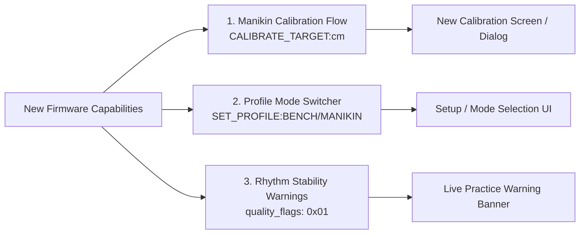

# CPReady: Recent Firmware Features & Mobile UI Flow Guide

**Target Audience**: Mobile Application Developers (Flutter), UI/UX Designers, and QA Testers  
**Hardware Platform**: ESP32 Dev Module (Dual MPU6050 Motion Engine)  
**Document Purpose**: Implementation specification for newly added firmware features, detailing exact UI screens, user journeys, interaction diagrams, and BLE command protocols needed in the mobile app.

---

## 1. Executive Summary: What Changed in Firmware

The CPReady firmware has recently been updated with three major feature subsystems:

1. **1-Step Manikin Depth Calibration**: The ESP32 can now auto-calculate and persist its harmonic depth constant $K$ directly into flash memory when provided with a target ground-truth depth from the manikin.
2. **Dual Kinematic Profiles**: Support for two distinct operating modes—**Adult Manikin Mode** (stiff spring, AHA thresholds) and **Bench Test Mode** (hand/desk pressing, relaxed sensitivity).
3. **Stroke Quality & Cadence Stability Bitfield (`quality_flags`)**: The BLE telemetry packet is now **12 bytes**, adding real-time flags for rhythm jitter, first-stroke/post-pause recovery, and active profile.



---

## 2. Screen 1: Manikin Calibration Flow & Screen

### 2.1 The Problem It Solves
Different CPR manikins (e.g., Laerdal Little Anne, Prestan Professional) have varying chest spring stiffnesses and friction. The instructor needs a simple, guided 30-second workflow to calibrate the vest to match the manikin's built-in mechanical clicker or proprietary app.

### 2.2 User Journey & Interaction Flow
The calibration flow consists of three sequential steps:

```
[ Step 1: Pre-Run Setup ]
      │
      ▼
[ Step 2: 15-Second Guided Vest Run ] ──(Auto-Stops via SET_TIME:15)
      │
      ▼
[ Step 3: Reference Input Dialog ] ──("What did the manikin report?")
      │
      ▼
[ Step 4: Instant Flash NVS Confirmation ]
```

### 2.3 Proposed UI Wireframe & Layout

```
+-------------------------------------------------------+
|  <- Back              Manikin Calibration             |
+-------------------------------------------------------+
|                                                       |
|  [ Step 1 of 2: Practice Run ]                        |
|  Perform 15 seconds of compressions to the manikin's  |
|  built-in clicker depth.                              |
|                                                       |
|               +-----------------------+               |
|               |         15 s          |               |
|               |    TIME REMAINING     |               |
|               +-----------------------+               |
|                                                       |
|               [  START CALIBRATION TRIAL  ]           |
|                                                       |
+-------------------------------------------------------+
                         │
                         ▼ (Trial Ends)
+-------------------------------------------------------+
|  CALIBRATION TRIAL COMPLETE                           |
+-------------------------------------------------------+
|  Vest Measured Mean Depth: 4.40 cm                    |
|                                                       |
|  Enter the Manikin's Reported Depth:                  |
|  +-------------------------------------------------+  |
|  |  5.2                                        cm  |  |
|  +-------------------------------------------------+  |
|  * Hint: Check the manikin app or use 5.0 cm if using |
|    the mechanical clicker.                            |
|                                                       |
|        [ CANCEL ]             [ SAVE CALIBRATION ]    |
+-------------------------------------------------------+
                         │
                         ▼ (On Save Tap)
+-------------------------------------------------------+
|  SUCCESS!                                             |
|  Calibration saved to vest flash memory.              |
|  New Scale Factor: K = 13.24                          |
|                                                       |
|                   [ RETURN TO HOME ]                  |
+-------------------------------------------------------+
```

### 2.4 BLE Protocol Sequence
1. When the instructor taps **"Start Calibration Trial"**:
   - App writes `"SET_TIME:15"` to Command Characteristic (`6e400003-...`).
   - App writes `"CALIBRATE"` to initiate 2.0s baseline.
   - Once `packet_type == 3` (Success), app writes `"START"`.
2. Compressions occur for 15 seconds.
3. Once timer reaches 15 seconds:
   - ESP32 automatically finalizes, transmits `packet_type = 4 (PKT_TYPE_FINAL_SUMMARY)`, and returns to `STANDBY`.
   - App displays the dialog with the vest's measured depth (`summary.depthCm`).
4. Instructor inputs the manikin's ground truth (e.g. `5.2`) and taps **"Save Calibration"**:
   - App writes:
     ```text
     CALIBRATE_TARGET:5.2
     ```
   - The ESP32 calculates:
     $$K_{\text{new}} = K_{\text{current}} \times \left(\frac{5.2}{\bar{D}_{\text{vest}}}\right)$$
   - The ESP32 persists $K_{\text{new}}$ into Flash NVS (survives power off).

---

## 3. Screen 2: Kinematic Profile Switcher (Setup Screen)

### 3.1 The Problem It Solves
- **Adult CPR Manikins** have stiff 50 kg springs requiring firm acceleration to trigger downstroke detection (`0.45g`).
- **Bench / Desk Testing** (compressing the vest with your palm on a desk without a spring) produces gentler acceleration peaks (`0.20–0.30g`). Previously, hand-pressing on a desk would miss strokes or fail recoil detection.

### 3.2 UI Screen Placement
Add a **"Kinematic Sensitivity Profile"** selector to the **Practice Setup Screen** (`practice_setup_screen.dart`) or in a dedicated **Device Settings Sheet**:

```
+-------------------------------------------------------+
|  Training Mode Profile                                |
+-------------------------------------------------------+
|                                                       |
|  (•) Adult Manikin Mode (Recommended)                 |
|      Standard AHA thresholds for training manikins.   |
|      - Start Trigger: 0.45g | Recoil: -0.35g          |
|      - Target Depth: 5.0 - 6.0 cm                     |
|                                                       |
|  ( ) Hand / Bench Test Mode                           |
|      Relaxed sensitivity for desk & palm testing      |
|      without a physical manikin spring.               |
|      - Start Trigger: 0.25g | Recoil: -0.18g          |
|                                                       |
+-------------------------------------------------------+
```

### 3.3 BLE Command Protocol
- If user selects **Adult Manikin Mode**:
  - App writes: `"SET_PROFILE:MANIKIN"`
  - ESP32 sets start threshold to `0.45g`, recoil to `-0.35g`, $K=11.2$, and saves to Flash NVS.
- If user selects **Hand / Bench Test Mode**:
  - App writes: `"SET_PROFILE:BENCH"`
  - ESP32 sets start threshold to `0.25g`, recoil to `-0.18g`, $K=9.5$, and saves to Flash NVS.

---

## 4. Screen 3: Live Practice Rhythm & Stability Enhancements

### 4.1 Telemetry Packet Update (12-Byte Specification)
The telemetry packet streamed over the Metrics Characteristic (`6e400002-...`) has been expanded from 11 bytes to **12 bytes**:

| Byte Offset | Field Name | Type | Description |
| :---: | :--- | :---: | :--- |
| `0` | `packet_type` | `uint8` | `1`=Live, `2`=Calibrating, `3`=Ready, `4`=Summary, `5`=Error |
| `1` | `recoil_status` | `uint8` | `1`=Full Recoil, `0`=Leaning (Summary: Recoil Compliance %) |
| `2..3` | `rate_cpm` | `uint16` | Compressions per minute (Little-Endian) |
| `4..5` | `depth_tenths_mm` | `uint16` | Depth in 0.1 mm (e.g., `520` = 5.2 cm) (Little-Endian) |
| `6` | `ccf_percent` | `uint8` | Chest Compression Fraction % (`0..100`) |
| `7` | `audio_prompt_code` | `uint8` | Audio Guidance Cue Code (`0..6`) |
| `8` | `total_compressions`| `uint8` | Stroke sequence number / total compressions |
| `9..10`| `session_elapsed_sec`| `uint16`| Session duration in seconds (Little-Endian) |
| **`11`** | **`quality_flags`** | **`uint8`** | **Bitfield: Rhythm regularity & active profile** |

### 4.2 Quality Bitfield Flags (`quality_flags` at Byte 11)

```dart
// Dart bitmask helpers:
bool isSteadyCadence(int flags)          => (flags & 0x01) != 0; // Bit 0
bool isFirstStrokeOrPostPause(int flags) => (flags & 0x02) != 0; // Bit 1
bool isBenchModeActive(int flags)        => (flags & 0x04) != 0; // Bit 2
```

### 4.3 Live Practice Screen UI Additions (`live_practice_screen.dart`)

```
+-------------------------------------------------------+
|  LIVE PRACTICE                                01:24   |
+-------------------------------------------------------+
|                                                       |
|   +-----------------------------------------------+   |
|   |  ⚠️  Rhythm Unsteady: depth may fluctuate      |   | <-- [NEW BANNER]
|   +-----------------------------------------------+   |
|                                                       |
|                  RATE: 108 cpm                        |
|               [====●=========]                        |
|                                                       |
|                  DEPTH: 5.2 cm                        |
|               [======●=======]                        |
|                                                       |
|           RECOIL: OK  |  CCF: 82%                     |
|                                                       |
+-------------------------------------------------------+
```

1. **Unsteady Cadence Warning Banner**:
   - When `isSteadyCadence(flags) == false`:
     - Display a subtle yellow pill/banner at the top of the gauges:  
       `"⚠️ Rhythm unsteady: depth readings may fluctuate"`.
   - When `isSteadyCadence(flags) == true`:
     - Automatically hide the banner.
2. **First Stroke / Post-Pause Damping**:
   - When `isFirstStrokeOrPostPause(flags) == true`:
     - The firmware has safely anchored the cycle period to `0.55s` to avoid false 10 cm ceiling spikes. The UI should render the stroke normally without jitter animation.
3. **Active Profile Badge**:
   - If `isBenchModeActive(flags) == true`:
     - Show a small pill tag: `[BENCH MODE]` next to the session timer so the user is aware strict manikin thresholds are bypassed.

---

## 5. Complete BLE Command Reference for Mobile Developers

All commands are sent as plain ASCII strings to the **Command Characteristic** (`6e400003-b5a3-f393-e0a9-e50e24dcca9e`):

| Command String | Arguments | Use Case in Mobile UI |
| :--- | :--- | :--- |
| `"CALIBRATE"` | None | User taps "Calibrate Hands" or enters Hand Placement screen. Starts 2.0s zero-gravity baseline. |
| `"START"` | None | User taps "Begin Session". Allowed only after `packet_type == 3` (Calib Success). |
| `"STOP"` | None | User presses and holds "End Session". Triggers Type 4 summary packet. |
| `"PAUSE"` | None | User taps "Pause Session". Pauses timer and CCF accrual. |
| `"RESUME"` | None | User taps "Resume Session". Restores live monitoring. |
| `"GET_RESULTS"` | None | Used if Type 4 packet was missed or dropped during disconnect. Requests immediate re-broadcast. |
| `"SET_TIME:<sec>"` | `<sec>` (Integer) | Sets automatic practice duration (e.g. `"SET_TIME:120"` for 2 min, `"SET_TIME:15"` for calibration, `"SET_TIME:0"` for unlimited). |
| `"SET_K:<val>"` | `<val>` (Float: `1.0..30.0`) | Directly sets depth scalar $K$ and persists to flash (e.g. `"SET_K:11.2"`). |
| `"SET_PROFILE:BENCH"` | None | Switches to relaxed hand/desk testing thresholds. Persists to flash. |
| `"SET_PROFILE:MANIKIN"` | None | Switches to standard adult manikin spring thresholds. Persists to flash. |
| `"CALIBRATE_TARGET:<cm>"` | `<cm>` (Float: e.g. `5.2`) | Auto-computes $K_{\text{new}} = K \times (\text{target} / \bar{D})$ and persists to flash. |
| `"RESET_CONFIG"` | None | Clears flash storage partition and resets firmware to factory defaults (`MANIKIN_STANDARD`, $K=11.2$). |
| `"GET_CONFIG"` | None | Emits current configuration parameters over ESP32 Serial console. |

---

## 6. Flutter / Dart Packet Parser (Drop-in Class)

Copy-paste this updated parser into your Flutter app's BLE service layer:

```dart
import 'dart:typed_data';

class CPRMetrics {
  final int packetType;         // 1=Live, 2=Calib Progress, 3=Calib Success, 4=Summary, 5=Error
  final bool recoilComplete;    // (If packetType == 1: true=Full Recoil, false=Leaning)
  final int recoilPercentage;   // (If packetType == 4: 0..100%)
  final int rateCpm;            // Current or average rate (cpm)
  final double depthCm;         // Current or average depth (cm)
  final double depthMm;         // Current or average depth (mm)
  final int ccfPercent;         // Current or final CCF % (0..100%)
  final int audioPromptCode;    // 0..6 (Voice coaching code)
  final int totalCompressions;  // Live stroke index or total compressions
  final int elapsedSeconds;     // Elapsed session duration in seconds
  final int qualityFlags;       // Bit 0=Steady, Bit 1=First/Pause, Bit 2=Bench Mode

  // Quality Bitfield Getters
  bool get isSteadyCadence => (qualityFlags & 0x01) != 0;
  bool get isFirstStrokeOrPostPause => (qualityFlags & 0x02) != 0;
  bool get isBenchMode => (qualityFlags & 0x04) != 0;

  CPRMetrics({
    required this.packetType,
    required this.recoilComplete,
    required this.recoilPercentage,
    required this.rateCpm,
    required this.depthCm,
    required this.depthMm,
    required this.ccfPercent,
    required this.audioPromptCode,
    required this.totalCompressions,
    required this.elapsedSeconds,
    required this.qualityFlags,
  });

  factory CPRMetrics.fromBytes(List<int> bytes) {
    if (bytes.length < 11) {
      throw ArgumentError("Expected at least 11 bytes, got ${bytes.length}");
    }
    final byteData = ByteData.sublistView(Uint8List.fromList(bytes));

    final type = byteData.getUint8(0);
    final recoilVal = byteData.getUint8(1);
    final rate = byteData.getUint16(2, Endian.little);
    final depthTenths = byteData.getUint16(4, Endian.little);
    final ccf = byteData.getUint8(6);
    final audioCue = byteData.getUint8(7);
    final totalCount = byteData.getUint8(8);
    final elapsed = byteData.getUint16(9, Endian.little);
    
    // Byte 11: quality_flags (Backwards compatible if older 11-byte packet received)
    final flags = (bytes.length >= 12) ? byteData.getUint8(11) : 0x01;

    return CPRMetrics(
      packetType: type,
      recoilComplete: recoilVal == 1,
      recoilPercentage: recoilVal,
      rateCpm: rate,
      depthCm: depthTenths / 100.0,
      depthMm: depthTenths / 10.0,
      ccfPercent: ccf,
      audioPromptCode: audioCue,
      totalCompressions: totalCount,
      elapsedSeconds: elapsed,
      qualityFlags: flags,
    );
  }
}
```

---

## 7. Summary Checklist for Flutter Developers

- [ ] **Create Calibration Screen / Dialog**:
  - Implement 15-second guided run (`SET_TIME:15`, `START`).
  - Capture user input for reference depth ($D_{\text{manikin}}$).
  - Transmit `CALIBRATE_TARGET:<val>` and show success banner.
- [ ] **Add Mode Selector**:
  - Add segmented control / radio buttons for **Adult Manikin** vs. **Bench Test** mode.
  - Send `SET_PROFILE:MANIKIN` or `SET_PROFILE:BENCH`.
- [ ] **Add Cadence Warning Pill in Live Practice**:
  - Check `isSteadyCadence`. Show warning when `false`.
- [ ] **Update Packet Parser**:
  - Adopt 12-byte `CPRMetrics.fromBytes()` with `quality_flags`.
