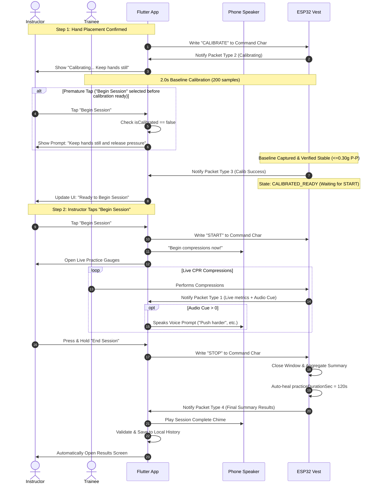
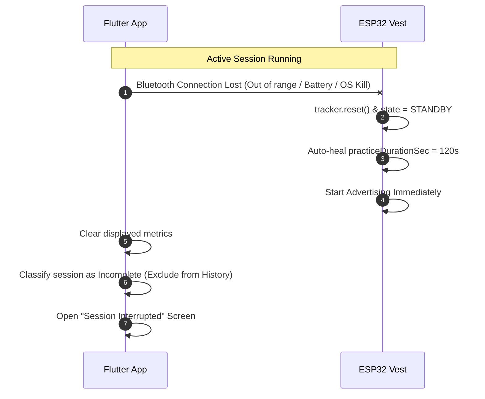
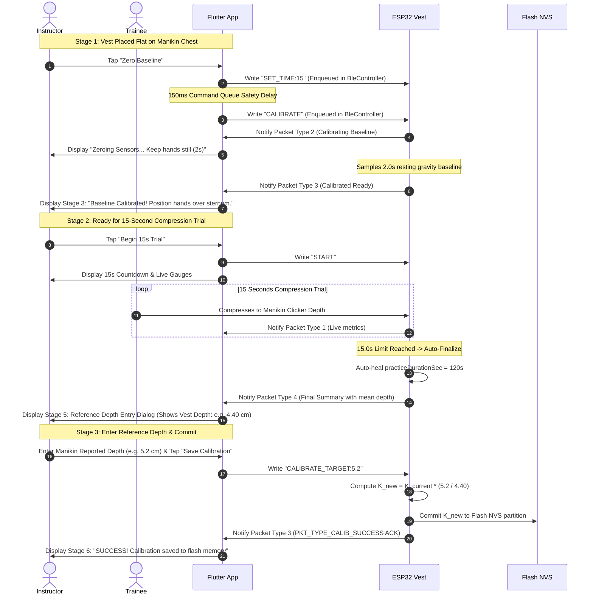

# CPReady Software Developer Integration Guide

**Target Audience**: Flutter / Mobile Application Developers & Firmware Contributors  
**Hardware Platform**: ESP32 Dev Module (Dual MPU6050 Accelerometers)  
**Primary Communication**: Bluetooth Low Energy (Nordic UART Service GATT Profile)  
**Document Status**: Official Protocol Specification (Aligned with Capstone Proposal)  

---

## 1. System Overview

The **CPReady** firmware turns an ESP32 into a smart CPR training vest worn over a resuscitation manikin. It tracks the four core American Heart Association (AHA) quality metrics:
- **Compression Rate**: Target 100–120 compressions per minute (cpm).
- **Compression Depth**: Target 50–60 mm (5.0–6.0 cm).
- **Chest Recoil**: Verification of complete upward chest release between downstrokes (flags rescuer leaning).
- **Chest Compression Fraction (CCF)**: Target $\ge 60\%$, ideally $> 80\%$ active compression time.

### Audio & Voice Guidance Architecture
All audio guidance, pacing prompts, and status announcements are handled entirely on the mobile smartphone via the Flutter mobile application:
- **Status Cues**: Delivered by the mobile app upon receiving BLE packet state transitions (`packet_type = 2` for calibration underway, `packet_type = 3` for session ready, `packet_type = 4` for session summary).
- **Spoken Voice Coaching**: Delivers real-time spoken prompts (*"Push harder"*, *"Release completely"*, *"Speed up"*, *"Slow down"*, *"Good compressions"*) matching the packet's `audio_prompt_code`.

---

## 2. Technical Verification Resolutions (Hardware to Software Agreement)

Below are the explicit engineering agreements answering the **"For Technical Verification"** requirements in the student team's protocol specification:

### 1. Bluetooth Disconnection Handling
- **Firmware Behavior**: The ESP32 detects client disconnection instantly via `onDisconnect()`. On the very next tick, the firmware clears `tracker.reset()`, resets `state = DeviceState::STANDBY`, auto-heals `practiceDurationSec = DEFAULT_PRACTICE_DURATION_SEC` (120s), and resumes BLE advertising.
- **Duration Self-Healing**: Regardless of whether the device was in an abbreviated 15-second calibration run or a custom-timed trial, disconnecting immediately restores the default 120-second practice limit. This guarantees that subsequent normal training sessions never experience abrupt 15-second premature terminations.
- **Flutter Behavior**: When disconnection occurs, Flutter immediately terminates the active session, clears displayed live metrics to avoid showing stale data, and displays the *"Session Interrupted"* notification screen. Interrupted sessions are **not** saved to History.
- **Reconnection**: The ESP32 resumes advertising immediately. Once re-paired, the instructor can initiate a clean new practice session.

### 2. STOP Command & Final Results Finalization
- **Sequence**:
  1. Instructor presses and holds "End Session" in Flutter.
  2. Flutter transmits the text string `"STOP"` to the Command Characteristic (`6e400003-...`).
  3. The ESP32 closes the measurement period, computes session averages (average depth, average rate, recoil compliance %, final CCF %, total compressions), and broadcasts a 12-byte summary packet with `packet_type = 4 (PKT_TYPE_FINAL_SUMMARY)`.
  4. The ESP32 transitions to `STANDBY` and self-heals `practiceDurationSec = DEFAULT_PRACTICE_DURATION_SEC` (120s).
  5. Flutter validates the packet, saves the session to local SQLite/Hive storage, and opens the Results screen.

### 3. Distinguishing Real-Time Telemetry from Finalized Results
- **Byte 0 of the packet** is an explicit `packet_type`:
  - `1`: Real-time streaming metrics (updated per stroke or at 5 Hz).
  - `2`: Baseline calibration in progress.
  - `3`: Calibration successfully completed or calibration target acknowledged (`PKT_TYPE_CALIB_SUCCESS`).
  - `4`: Finalized session summary results (trigger for app to auto-save and open Results).
  - `5`: Error / calibration failed.

### 4. Response Timeout & Validation Rules
- **Agreed Timeout**: **2.0 seconds** (2000 ms). If Flutter sends `"STOP"` and does not receive a Type 4 packet within 2.0s, it displays the *"Results Unavailable"* screen.
- **Validation Criteria**: Flutter verifies `bytes.length >= 11` (12 bytes expected in current protocol), `rate <= 250`, `depth_tenths_mm <= 1000` (10.0 cm), and `ccf <= 100`.

### 5. Final Results Retransmission (`"GET_RESULTS"`)
- The ESP32 retains `lastFinalSummary` in RAM.
- If Flutter fails to save or missed the Type 4 packet, writing `"GET_RESULTS"` causes the ESP32 to immediately re-notify the Type 4 summary packet.

### 6. Decoupled Pre-Session Calibration & Gated Session Start
- **Automatic Pre-Session Calibration**: As soon as the instructor confirms correct hand placement, Flutter writes text string `"CALIBRATE"` to the Command Characteristic (`6e400003-...`).
- **Stationary Baseline Sampling**: ESP32 broadcasts `packet_type = 2 (PKT_TYPE_CALIB_PROGRESS)` every 500 ms while sampling for 2.0 seconds (target: 200 samples).
- **Gated "Begin Session" Button**:
  - The *"Begin Session"* button is displayed on screen while calibration is in progress.
  - **Premature Tap Gating**: If the instructor taps *"Begin Session"* before calibration is ready, the session does **not** start. Flutter displays the prompt: *"Keep hands still and release downward pressure."* If `"START"` is received by the ESP32 while calibrating, the firmware rejects it with `packet_type = 5 (PKT_TYPE_ERROR)`.
- **4-Tier Calibration Validation**: The firmware verifies:
  1. *Sample Completeness*: $\ge 150$ samples collected (at least 75% of expected 200).
  2. *Dynamic Motion Stability*: Peak-to-peak spread $\le 0.30\text{g}$ net differential, $\le 0.25\text{g}$ chest, and $\le 0.20\text{g}$ base.
  3. *Static Gravity Bounds*: Resting baselines satisfy $0.65\text{g} \le g \le 1.35\text{g}$.
  4. *Sensor Alignment / Pre-Pressure*: Sternum vs. spine divergence $|a_{\text{chest}} - a_{\text{base}}| \le 0.35\text{g}$.
- **Calibration Completion**: Once verified, the ESP32 transmits `packet_type = 3 (PKT_TYPE_CALIB_SUCCESS)` and transitions to `CALIBRATED_READY`. Flutter updates the UI to indicate the session is ready.
- **Starting the Practice Session**: When the instructor taps *"Begin Session"*, Flutter writes `"START"`, and live CPR tracking starts immediately (`packet_type = 1`).

### 7. Manikin Comparative Depth Calibration Protocol
- **Purpose**: Dynamically tune the vest's depth constant $K$ to match the mechanical travel and spring resistance of specific training manikins (e.g. Laerdal, Prestan).
- **Dual-Queue Resilience**:
  - *Firmware*: An 8-entry FreeRTOS FIFO queue (`commandQueue`) in `BleManager` buffers incoming BLE write callbacks, ensuring commands are never dropped during rapid sequences.
  - *Mobile App*: `BleController._commandQueue` paces all outgoing GATT writes sequentially with an enforced **150ms delay** between transmissions, preventing Android/iOS GATT 133/22 connection drops.
- **Decoupled 5-Stage Protocol**:
  1. *Stage 1 (Intro)*: User places vest on manikin and taps "Zero Baseline".
  2. *Stage 2 (Zeroing)*: App sends `"SET_TIME:15"` followed by `"CALIBRATE"` (150ms paced). ESP32 samples 2.0s resting baseline (`packet_type = 2`).
  3. *Stage 3 (Ready)*: ESP32 confirms baseline with `packet_type = 3`. App enables "Begin 15s Trial" button, allowing rescuer to position hands over sternum without rushing.
  4. *Stage 4 (15s Trial)*: Rescuer taps "Begin 15s Trial" (`"START"`). Compressions run for 15s. On timeout, ESP32 auto-finalizes, restores `practiceDurationSec = 120s`, and notifies `packet_type = 4` with measured mean depth $\bar{D}_{\text{vest}}$.
  5. *Stage 5 (Target Entry & ACK)*: User enters manikin clicker depth $D_{\text{manikin}}$ (e.g., 5.2 cm). App sends `"CALIBRATE_TARGET:5.2"`. ESP32 computes:
     $$K_{\text{new}} = K_{\text{current}} \times \left(\frac{D_{\text{manikin}}}{\bar{D}_{\text{vest}}}\right)$$
     commits $K_{\text{new}}$ to Flash NVS, and immediately broadcasts `packet_type = 3 (PKT_TYPE_CALIB_SUCCESS)` as confirmation ACK. App displays the "Calibration Saved!" banner.

---

## 3. Telemetry Packet Specification (12 Bytes Packed)

```
SERVICE UUID:        6e400001-b5a3-f393-e0a9-e50e24dcca9e
METRICS CHAR UUID:   6e400002-b5a3-f393-e0a9-e50e24dcca9e  (Notify)
COMMAND CHAR UUID:   6e400003-b5a3-f393-e0a9-e50e24dcca9e  (Write)
```

| Byte Offset | Field Name | Type | Real-Time Meaning (`type=1`) | Final Summary Meaning (`type=4`) |
| :---: | :--- | :---: | :--- | :--- |
| **0** | `packet_type` | `uint8` | `1` (Live Stream) | `4` (Finalized Session Results) |
| **1** | `recoil_status` | `uint8` | `1` = Full Recoil, `0` = Leaning | Overall Recoil Compliance % (`0..100`) |
| **2..3** | `rate_cpm` | `uint16` | Instantaneous cadence (cpm) | Session Average Cadence (cpm) |
| **4..5** | `depth_tenths_mm` | `uint16` | Stroke depth in 0.1 mm (e.g. 550 = 55mm) | Session Average Depth in 0.1 mm |
| **6** | `ccf_percent` | `uint8` | Current cumulative CCF % (`0..100`) | Final Session CCF % (`0..100`) |
| **7** | `audio_prompt_code` | `uint8` | Audio Guidance Cue Code (`0..6`) | `0` (Unused in summary) |
| **8** | `total_compressions`| `uint8` | Current stroke sequence count | Total compressions delivered in session |
| **9..10** | `session_elapsed_sec`| `uint16`| Elapsed session duration (seconds) | Total final session duration (seconds) |
| **11** | `quality_flags` | `uint8` | Stroke quality bitfield (steady cadence, pause fallback, profile) | Final Session Quality Flags (steady rhythm, bench profile) |

### Quality & Cadence Bitfield Flags (`quality_flags`)

Byte 11 conveys stroke quality, cadence regularity, and runtime kinematic profile flags:

| Bit Position | Bitmask | Flag Constant | Meaning / Behavior |
| :---: | :---: | :--- | :--- |
| **Bit 0** | `0x01` | `CADENCE_FLAG_STEADY` | `1` = Cadence jitter $\le 25\%$ (steady rhythm), `0` = Inconsistent cadence. When `0`, Flutter should display an on-screen warning banner: *"Rhythm unsteady: depth readings may fluctuate"*. |
| **Bit 1** | `0x02` | `CADENCE_FLAG_FIRST_OR_PAUSE` | `1` = First stroke of session or post-pause recovery stroke (period exceeded 0.85s and was safely bounded to fallback 0.55s). |
| **Bit 2** | `0x04` | `CADENCE_FLAG_BENCH_MODE` | `1` = Bench testing profile active (`BENCH_TEST`), `0` = Standard manikin profile (`MANIKIN_STANDARD`). |
| **Bits 3..7** | — | *Reserved* | Set to `0` for future extensions. |

### Audio Guidance Cue Codes (`audio_prompt_code`)

The firmware contains a smart coaching engine with **3.5-second error persistence windowing** and a **5.0-second silence cooldown**. When a non-zero code is received, Flutter simply plays the corresponding voice prompt through the phone speaker:

| Code | Constant | Spoken Voice Prompt Phrase | Trigger Condition |
| :---: | :--- | :--- | :--- |
| **0** | `PROMPT_NONE` | *(Silence)* | Technique is compliant or prompt cooldown active |
| **1** | `PROMPT_PUSH_HARDER` | *"Push harder"* | Depth < 50 mm sustained for $\ge 3.5\text{ s}$ |
| **2** | `PROMPT_PUSH_LESS` | *"Push shallower"* | Depth > 60 mm sustained for $\ge 3.5\text{ s}$ |
| **3** | `PROMPT_RELEASE_FULLY` | *"Release chest completely"* | Recoil < -0.35g (leaning) sustained for $\ge 3.5\text{ s}$ |
| **4** | `PROMPT_SPEED_UP` | *"Speed up"* | Rate < 100 cpm sustained for $\ge 3.5\text{ s}$ |
| **5** | `PROMPT_SLOW_DOWN` | *"Slow down"* | Rate > 120 cpm sustained for $\ge 3.5\text{ s}$ |
| **6** | `PROMPT_GOOD_JOB` | *"Good compressions"* | Target metrics maintained continuously for $\ge 15\text{ s}$ |

---

## 4. Flutter / Dart Integration Code

Copy-paste this complete parser and handler directly into your Flutter project:

```dart
import 'dart:typed_data';
import 'package:flutter_tts/flutter_tts.dart';

class CPRMetrics {
  final int packetType;         // 1=Live, 2=Calib Progress, 3=Calib Done, 4=Final Summary, 5=Error
  final bool recoilComplete;    // (If packetType == 1)
  final int recoilPercentage;   // 0..100% (If packetType == 4)
  final int rateCpm;            // Current or average rate
  final double depthCm;         // Current or average depth in cm
  final double depthMm;         // Current or average depth in mm
  final int ccfPercent;         // Cumulative CCF %
  final int audioPromptCode;    // 0..6
  final int totalCompressions;  // Total stroke count
  final int elapsedSeconds;     // Total duration in seconds
  final int qualityFlags;       // Bit 0=Steady, Bit 1=First/Pause, Bit 2=Bench Mode

  bool get isSteadyCadence => (qualityFlags & 0x01) != 0;
  bool get isFirstStrokeOrPostPause => (qualityFlags & 0x02) != 0;
  bool get isBenchMode => (qualityFlags & 0x04) != 0;

  CPRMetrics({
    required this.packetType,
    required this.recoilComplete,
    required this.recoilPercentage,
    required this.rateCpm,
    required this.depthCm,
    required this.depthMm,
    required this.ccfPercent,
    required this.audioPromptCode,
    required this.totalCompressions,
    required this.elapsedSeconds,
    this.qualityFlags = 0x01,
  });

  factory CPRMetrics.fromBytes(List<int> bytes) {
    if (bytes.length < 11) {
      throw ArgumentError("Expected 11 bytes, got ${bytes.length}");
    }
    final byteData = ByteData.sublistView(Uint8List.fromList(bytes));

    final type = byteData.getUint8(0);
    final recoilVal = byteData.getUint8(1);
    final rate = byteData.getUint16(2, Endian.little);
    final depthTenths = byteData.getUint16(4, Endian.little);
    final ccf = byteData.getUint8(6);
    final audioCue = byteData.getUint8(7);
    final totalCount = byteData.getUint8(8);
    final elapsed = byteData.getUint16(9, Endian.little);
    final quality = byteData.lengthInBytes >= 12 ? byteData.getUint8(11) : 0x01;

    return CPRMetrics(
      packetType: type,
      recoilComplete: recoilVal == 1,
      recoilPercentage: recoilVal,
      rateCpm: rate,
      depthCm: depthTenths / 100.0,
      depthMm: depthTenths / 10.0,
      ccfPercent: ccf,
      audioPromptCode: audioCue,
      totalCompressions: totalCount,
      elapsedSeconds: elapsed,
      qualityFlags: quality,
    );
  }
}

// -----------------------------------------------------------------------------
// BLE Telemetry Stream Listener & Session Controller Example
// -----------------------------------------------------------------------------
class CPRSessionManager {
  final FlutterTts tts = FlutterTts();
  bool isCalibrated = false;
  bool isCalibrating = false;

  /// Called when the instructor confirms correct hand placement
  void startPreSessionCalibration(BleDevice device) {
    isCalibrated = false;
    isCalibrating = true;
    showCalibrationUI("Calibrating... Keep hands still and release downward pressure.");
    device.writeCommand("CALIBRATE");
  }

  /// Called when instructor taps "Begin Session" button
  void onBeginSessionTapped(BleDevice device) {
    if (!isCalibrated) {
      // Gating check: calibration is not ready yet!
      showPrompt("Please keep hands still and release downward pressure until calibration finishes.");
      return;
    }

    // Calibration is ready: initiate active session
    device.writeCommand("START");
    transitionToLivePractice();
  }

  void onCharacteristicChanged(List<int> rawBytes) {
    if (rawBytes.length < 11) return;
    final metrics = CPRMetrics.fromBytes(rawBytes);

    switch (metrics.packetType) {
      case 1: // REAL-TIME LIVE TELEMETRY
        updateLiveGauges(metrics);
        handleAudioCue(metrics.audioPromptCode);
        break;

      case 2: // CALIBRATION IN PROGRESS
        isCalibrating = true;
        showCalibrationProgress(metrics.elapsedSeconds);
        break;

      case 3: // CALIBRATION COMPLETE (READY)
        isCalibrated = true;
        isCalibrating = false;
        showCalibrationReady("Calibration ready! Tap Begin Session to start.");
        break;

      case 4: // FINALIZED SESSION SUMMARY
        saveToLocalHistory(metrics);
        navigateToResultsScreen(metrics);
        break;

      case 5: // CALIBRATION ERROR / PREMATURE START / EXCESSIVE MOTION
        isCalibrated = false;
        isCalibrating = false;
        showPrompt("Motion or leaning detected! Keep hands still and release downward pressure.");
        break;
    }
  }

  void handleAudioCue(int code) {
    switch (code) {
      case 1: tts.speak("Push harder"); break;
      case 2: tts.speak("Push shallower"); break;
      case 3: tts.speak("Release chest completely"); break;
      case 4: tts.speak("Speed up"); break;
      case 5: tts.speak("Slow down"); break;
      case 6: tts.speak("Good compressions"); break;
    }
  }

  void updateLiveGauges(CPRMetrics m) {
    // Update live depth / rate gauges...
    // If cadence is unsteady, show warning banner:
    if (!m.isSteadyCadence) {
      showCadenceWarning("Rhythm unsteady: depth readings may fluctuate.");
    } else {
      hideCadenceWarning();
    }
  }
  void showCadenceWarning(String msg) { /* display yellow warning pill/banner */ }
  void hideCadenceWarning() { /* dismiss warning pill */ }
  void showCalibrationUI(String msg) { /* display progress indicator */ }
  void showCalibrationProgress(int sec) { /* update 2-second progress */ }
  void showCalibrationReady(String msg) { /* enable Begin Session button */ }
  void showPrompt(String msg) { /* display warning toast/snackbar */ }
  void transitionToLivePractice() { /* open live pumping UI */ }
  void saveToLocalHistory(CPRMetrics m) { /* persist to SQLite / Hive */ }
  void navigateToResultsScreen(CPRMetrics m) { /* open Results page */ }
}
```

---

---

## 4.5. Mobile App BLE Command Reference (Write Characteristic: `6e400003-...`)

The mobile application sends ASCII text commands to control session flow, calibrate sensors, and dynamically tune kinematic sensitivity:

| Command | Arguments | Description | Example |
| :--- | :--- | :--- | :--- |
| `CALIBRATE` | None | Initiates 2.0-second stationary baseline calibration. | `CALIBRATE` |
| `START` | None | Begins active CPR session once calibrated. | `START` |
| `STOP` | None | Terminates active session and requests Type 4 summary packet. | `STOP` |
| `GET_RESULTS` | None | Retransmits the last session summary (Type 4) packet. | `GET_RESULTS` |
| `PAUSE` | None | Temporarily pauses active session timer and CCF accrual. | `PAUSE` |
| `RESUME` | None | Resumes paused session. | `RESUME` |
| `SET_TIME:<sec>` | `<sec>` (integer) | Overrides trial duration limit (0 = indefinite). **Auto-restores to 120s on session end, abort, STOP, or disconnect.** | `SET_TIME:120` |
| `SET_K:<val>` | `<val>` (1.0..30.0) | Sets depth harmonic scalar $K$ and persists to flash NVS. | `SET_K:11.2` |
| `SET_PROFILE:BENCH` | None | Activates bench test thresholds (0.25g start, -0.18g recoil, K=9.5) and persists to NVS. | `SET_PROFILE:BENCH` |
| `SET_PROFILE:MANIKIN` | None | Activates standard adult manikin thresholds (0.45g start, -0.35g recoil, K=11.2) and persists to NVS. | `SET_PROFILE:MANIKIN` |
| `CALIBRATE_TARGET:<target>` | `<target>` (float cm) | Performs proportional calibration: $K_{\text{new}} = K \times (\text{target} / \bar{D})$, saves to NVS, and **emits Packet Type 3 (`PKT_TYPE_CALIB_SUCCESS`) ACK**. | `CALIBRATE_TARGET:5.5` |
| `RESET_CONFIG` | None | Clears flash NVS partition and restores factory defaults. | `RESET_CONFIG` |
| `GET_CONFIG` | None | Emits current configuration parameters over Serial for debugging. | `GET_CONFIG` |

## 5. Interaction Sequence Diagrams

### 5.1 Decoupled Pre-Session Calibration & Live Practice


### 5.2 Bluetooth Disconnection Abort


### 5.3 15-Second Manikin Depth Calibration Workflow


---

## 6. Demo & Simulation Mode (Test Without Hardware)

You do **not** need the physical sensors or manikin connected to build and test the mobile application:

1. Open [include/CPReadyConfig.h](file:///c:/Users/reynq/OneDrive/Documents/CPReady/CPReady_Program/include/CPReadyConfig.h).
2. Set `#define ENABLE_DEMO_MODE true`.
3. Flash the ESP32.

When you send `"START"`, the device broadcasts `type=2` (calibration underway), transitions after 2s to `type=3` (calibration ready), streams realistic live AHA metrics (`55 mm` depth, `110 cpm`, recoil OK, `74%` CCF) at 5 Hz, and transmits a finalized `type=4` summary upon `"STOP"`.

---

## 7. Hardware Wiring & PCA9548A I2C Multiplexer Architecture

To eliminate I2C address collisions between dual MPU-6050 sensors operating at default address `0x68`, CPReady routes downstream I2C traffic through a **PCA9548A / TCA9548A** 8-channel bidirectional I2C multiplexer.

### 7.1 Hardware Pinout & Wiring Table

| Subsystem Component | Component Pin | ESP32 GPIO / Connection | Description |
| :--- | :--- | :--- | :--- |
| **ESP32 Master** | GPIO 21 | PCA9548A `SDA` | Primary I2C Data (100 kHz) |
| **ESP32 Master** | GPIO 22 | PCA9548A `SCL` | Primary I2C Clock (100 kHz) |
| **PCA9548A** | `A0`, `A1`, `A2` | GND | Fixed I2C Address `0x70` |
| **PCA9548A** | `SD3`, `SC3` | Chest MPU `SDA`, `SCL` | Downstream Channel 3 (Chest Sensor) |
| **PCA9548A** | `SD2`, `SC2` | Base MPU `SDA`, `SCL` | Downstream Channel 2 (Spine / Baseplate Sensor) |
| **MPU 1 (Chest)** | `AD0` | GND | I2C Address `0x68` (Isolated on Channel 3) |
| **MPU 2 (Base)** | `AD0` | GND | I2C Address `0x68` (Isolated on Channel 2) |

### 7.2 Dynamic Multiplexer Auto-Scanning
At boot (`SensorManager::begin()`):
1. The firmware verifies the multiplexer is present at `0x70`.
2. It cycles through all 8 multiplexer channels (`SD0` to `SD7`), probing for active MPU-6050 devices at `0x68`.
3. Preferred channel assignments:
   - **Chest Sensor**: Defaults to **Channel 3 (`SD3`)**. If not detected on SD3, auto-maps to the first detected channel.
   - **Base Sensor**: Defaults to **Channel 2 (`SD2`)**. If plugged into an alternate channel, auto-maps to the second detected channel.
4. **Single vs. Dual MPU Toggle (`USE_DUAL_MPU`)**:
   - When `#define USE_DUAL_MPU false` in `CPReadyConfig.h`: Only Channel 3 (Chest) is sampled. Base sensor initialization and differential math are bypassed.
   - When `#define USE_DUAL_MPU true`: Both channels are sampled sequentially at 100 Hz (~0.38 ms total I2C switching overhead) to compute net compression acceleration:
     $$\text{rawNet} = -(a_{\text{chest}} - a_{\text{base}})$$
5. **Direct Bus Fallback**: If the PCA9548A is not connected and `USE_DUAL_MPU == false`, the firmware automatically falls back to direct main-bus communication with MPU 1 on GPIO 21/22.
