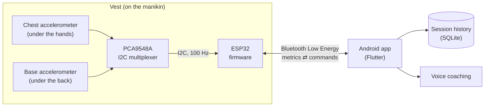
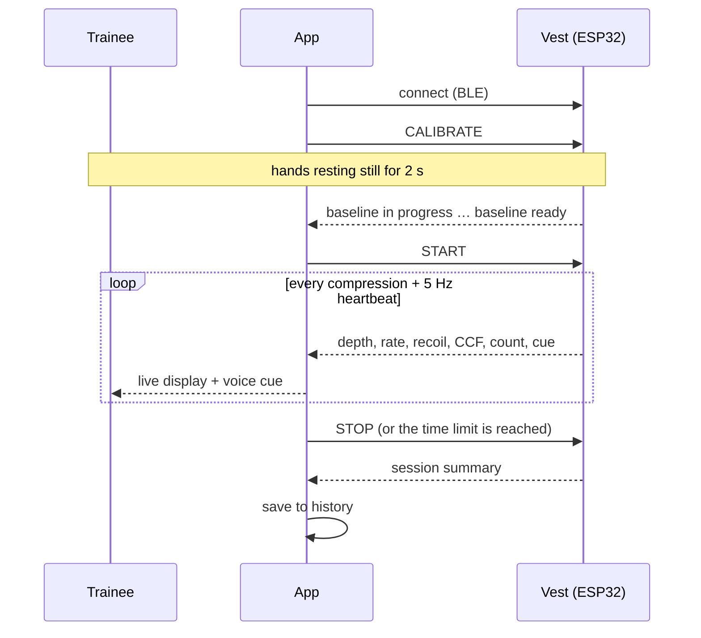
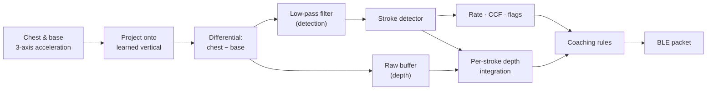
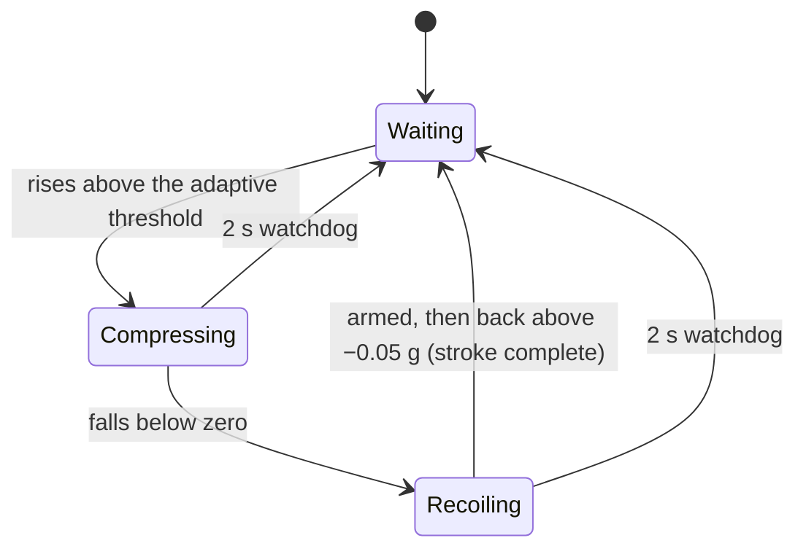

# CPReady

**An ESP32-based supplementary CPR training device and mobile application that gives
real-time, objective feedback on chest compressions.**

> *CPReady: Development and Evaluation of an ESP32-Based Integrated Supplementary
> Cardiopulmonary Resuscitation (CPR) Training Device and Mobile Application with Real-Time
> Objective Feedback and Progress Tracking for STEM–Health Allied Students.*
> Bataan National High School – Senior High School, research project, 2026–2027.

CPReady is a sensor vest worn by a CPR training manikin. It is paired with an Android app.
While a trainee performs chest compressions, the vest measures:

- compression depth;
- compression rate;
- chest compression fraction;
- an estimate of chest recoil.

These are the quality indicators emphasised by the American Heart Association
[[1]](#ref1)[[2]](#ref2). The app shows them live, speaks corrective coaching cues, and keeps
a history of every practice session.

> CPReady is a training aid for use on manikins. It is not a medical device and is not
> intended for use on people.

---

## Contents

1. [Background](#1-background)
2. [Aims and research questions](#2-aims-and-research-questions)
3. [System overview](#3-system-overview)
4. [Hardware](#4-hardware)
5. [How a practice session works](#5-how-a-practice-session-works)
6. [Signal processing and algorithms](#6-signal-processing-and-algorithms)
7. [Wireless protocol](#7-wireless-protocol)
8. [Mobile application](#8-mobile-application)
9. [Software verification](#9-software-verification)
10. [Repository structure](#10-repository-structure)
11. [Building and running](#11-building-and-running)
12. [About this project](#12-about-this-project)
13. [References](#13-references)

---

## 1. Background

Survival from cardiac arrest depends strongly on the quality of CPR. The AHA consensus on CPR
quality [[2]](#ref2) identifies the following as the main measurable components:

- adequate compression **depth** (5–6 cm in adults);
- an adequate **rate** (100–120 compressions per minute);
- **full chest recoil** between compressions;
- minimal interruptions, expressed as a high **chest compression fraction** (CCF).

It also lists avoiding excessive ventilation, which CPReady does not measure. The current
adult basic life support guidelines [[1]](#ref1) keep the same depth, rate and
recoil targets. Large observational studies link these targets to outcomes:

- survival was highest at depths of about 4.0–5.5 cm [[3]](#ref3);
- survival was highest at rates of about 100–120 per minute [[4]](#ref4);
- higher compression fractions were associated with better survival [[5]](#ref5).

Rescuers are poor judges of their own depth and rate. Real-time audiovisual feedback devices
have been shown to improve compression quality during training and practice
[[6]](#ref6). However, commercial feedback manikins and devices are costly. In many school
settings, training still relies on an instructor watching each trainee.

CPReady explores whether a **low-cost device**, built from an ESP32 microcontroller, two
consumer MEMS accelerometers and a smartphone, can provide this objective feedback to students
during instructor-led CPR training.

---

## 2. Aims and research questions

The study aims to develop and evaluate CPReady, an ESP32-based supplementary CPR training
device and mobile application, and to describe its measurement accuracy and system
functionality.

**Research questions**

1. How accurate are the CPR performance measurements of the prototype in terms of:
   1. compression depth (cm);
   2. compression rate (compressions per minute);
   3. chest recoil detection; and
   4. chest compression fraction (%)?
2. How may the system functionality of the prototype be described in terms of:
   1. response time from sensor detection to mobile application display (s);
   2. Bluetooth data transmission reliability (%);
   3. data logging completeness (%); and
   4. firmware algorithmic accuracy (%)?

The evaluation uses a quantitative, descriptive design. The device's outputs are compared
against an existing CPR feedback or measurement system, video recording with manual timing,
and assessment by a certified BLS instructor.

Several design features exist to support these questions:

- a sequence number in every Bluetooth packet (RQ 2.2);
- a per-session count of lost packets saved in the history (RQ 2.2, 2.3);
- automated, repeatable software tests of the measurement algorithms (RQ 2.4).

---

## 3. System overview



The firmware does all the measurement on the device. The app only displays the results,
coaches the trainee, and stores the sessions. Because of this split, the readings do not
depend on the phone's performance or timing.

---

## 4. Hardware

| Component | Role |
|---|---|
| ESP32 development board (`esp32dev`) | Sampling, signal processing, Bluetooth LE server |
| 2 × MPU-6050 / MPU-6500-class accelerometer [[9]](#ref9) | **Chest** sensor in the handpiece over the sternum; **base** sensor beneath the manikin's back |
| PCA9548A I2C multiplexer | Lets both sensors share one I2C address (0x68) on separate channels |
| Training manikin | Provides the compressible chest |

**Sensor configuration:**

- full-scale range of ±4 g;
- the sensor's internal 44 Hz low-pass filter (for anti-aliasing);
- I2C at 100 kHz on GPIO 21 (SDA) and 22 (SCL);
- a fixed-rate sampling schedule of **100 Hz**.

The firmware detects the wiring at start-up. It supports the multiplexer layout and also
two sensors wired directly at addresses 0x68 and 0x69.

**Why two sensors?** When a manikin rests on a soft surface (a mattress or a mat), each
compression also pushes the surface down, and a single chest sensor would count that motion
as compression depth. Subtracting the base sensor's motion from the chest sensor's leaves
only the compression of the chest itself. This dual-accelerometer approach is described by
Ruiz de Gauna et al. [[8]](#ref8).

---

## 5. How a practice session works



1. **Baseline capture (2 s).**
   - The trainee rests their hands on the chest without pushing.
   - The vest averages 200 samples from each sensor and learns the direction of gravity for
     each one.
   - It checks that the hands were still, that each sensor reads a plausible 1 g, and that
     the two sensors agree. If any check fails, it asks for a retry.
2. **Compressions.** After `START`, the vest measures every stroke. It sends a packet at the
   end of each compression, plus a 5 Hz heartbeat so the display stays current during pauses.
3. **End of session.** The session stops at the configured duration (120 s by default) or on
   `STOP`. The vest then sends a summary with averages, compression fraction and the total
   count, which the app saves.

---

## 6. Signal processing and algorithms

All processing runs on the ESP32 at 100 samples per second.



### 6.1 Vertical acceleration and the differential signal

At rest an accelerometer measures only gravity. During baseline capture, the firmware takes
the mean resting vector $\bar{\mathbf g}$ of each sensor. Its unit vector
$\hat{\mathbf u} = \bar{\mathbf g}/\lVert\bar{\mathbf g}\rVert$ points "up" in that sensor's
own axes. Each new sample $\mathbf a$ is projected onto this vertical:

$$a_\text{dyn} = \mathbf a \cdot \hat{\mathbf u} - \lVert\bar{\mathbf g}\rVert$$

This measures vertical motion whatever angle the sensor is mounted at; using one sensor axis
alone would under-read a tilted pad by $\cos\theta$. The net compression acceleration (in g,
positive downward) is the difference between the two sensors:

$$a_\text{net} = -\left(a_\text{dyn}^\text{chest} - a_\text{dyn}^\text{base}\right)$$

### 6.2 Filtering

Stroke **detection** uses a first-order exponential low-pass filter:

$$y_k = \alpha\, a_{\text{net},k} + (1-\alpha)\, y_{k-1}, \qquad \alpha = 0.25 \;(f_c \approx 4.6\ \text{Hz})$$

This passes the compression frequency (about 1.7–2 Hz) and suppresses sensor noise and
impact spikes. **Depth** is computed from the *unfiltered* signal, because a filter would
shrink and delay the motion being measured.

### 6.3 Stroke detection

Each compression is tracked by a three-state machine on the filtered signal.



- **Adaptive start threshold.** The threshold follows the strength of the trainee's own
  strokes:
  $\theta = \mathrm{clamp}(0.4\,E,\ 0.12\ \text{g},\ \theta_\text{profile})$, where
  $E$ is a decaying envelope of $|y|$ with a half-life of about 1 s. Gentle and shallow
  compressions are still detected, and noise is not.
- **Lockouts.** A new stroke may start no sooner than 300 ms after the previous stroke
  *started* (a ceiling of 200 cpm), and at least 80 ms after the previous one ended.
- **Armed recoil.** A stroke can only finish after the signal has swung clearly negative,
  by at least 30 % of the stroke's peak and at least 0.08 g. This prevents a stroke from
  being closed half-way through.
- **Bump rejection.** A detection whose reconstructed chest motion (§6.4) is smaller than
  1 cm is not counted. Bumping or repositioning the hands is not a compression.

Two detection profiles are available. **Manikin** is the default. **Bench** uses more
sensitive thresholds for testing without a manikin spring.

### 6.4 Compression depth: cycle-bounded double integration

Integrating acceleration twice gives displacement. Integrating over a long period, however,
makes the result drift. CPReady avoids drift by integrating each stroke **on its own short
window, with boundary conditions**. This is the approach of the classic accelerometer-based
depth estimators [[7]](#ref7). It needs no assumption about the shape of the stroke.

**Normal strokes.** The window runs from the end of the previous stroke to the end of this
one: exactly one compression cycle of $N$ samples, with $\Delta t = 0.01$ s. Over a full
cycle the chest ends where it started, so both the mean acceleration and the mean velocity
must be zero. Removing them cancels sensor offset and supplies the unknown velocity at the
window edge:

$$
\begin{aligned}
v_i &= \sum_{j \le i} \left(a_j - \bar a\right)\Delta t, \qquad \bar a = \tfrac{1}{N}\sum_j a_j\\
x_i &= \sum_{j \le i} \left(v_j - \bar v\right)\Delta t, \qquad \bar v = \tfrac{1}{N}\sum_j v_j\\
D &= g_0\left(\max_i x_i - \min_i x_i\right), \qquad g_0 = 980.665\ \text{cm/s}^2
\end{aligned}
$$

**First stroke, or the first after a pause.** There is no previous cycle, but the chest was
at rest. So integration starts from zero velocity and zero displacement shortly before the
push, using the resting level just before it as zero acceleration. If the chest was not
actually still, no depth is reported for that stroke rather than an unreliable one.

A ring buffer keeps the last 2.56 s of samples (1 KB), so depth costs only a few hundred
additions per stroke.

### 6.5 Compression rate

The period of each stroke is the time between consecutive stroke completions. The displayed
rate is

$$r = \frac{60\,000}{\mathrm{median}(T_k, T_{k-1}, T_{k-2})\ [\text{ms}]}$$

so that a single uneven stroke does not swing the display or start a coaching cue. The first
stroke of a session and the first after a pause have no meaningful period, so they report no
rate. The session average is the number of steadily paced strokes per minute of compressing.

### 6.6 Chest compression fraction (CCF)

$$\text{CCF} = \frac{\text{time spent compressing}}{\text{session time}} \times 100\,\%$$

A gap of more than 1.5 s between strokes counts as a pause and earns no compressing time.
CCF is updated with every sample, so it falls during a pause. Explicit PAUSE / RESUME
commands stop the session clock altogether. The session summary grades a CCF of 80 % or
more as good and below 60 % as poor, consistent with [[2]](#ref2)[[5]](#ref5).

### 6.7 Chest recoil (estimate)

Full recoil means the rescuer releases all pressure between compressions. CPReady infers
recoil from the strength of the upward rebound in the acceleration signal. A rescuer leaning
steadily on the chest produces no acceleration, so an accelerometer can only *estimate*
recoil; measuring residual leaning force directly requires a force sensor. For this reason
the vest flags recoil as **estimated**, the app labels it that way, and it is not used for
grading or voice cues.

### 6.8 Real-time coaching

After each stroke the firmware decides whether a voice cue is needed:

| Cue | Condition (sustained for 6 strokes or 3.5 s) |
|---|---|
| "Push harder" | depth < 5.0 cm |
| "Push shallower" | depth > 6.0 cm |
| "Speed up" | rate < 100 cpm |
| "Slow down" | rate > 120 cpm |
| "Good compressions" | 15 s on target (praise) |

How cues are chosen and delivered:

- **Priority:** depth is checked before rate, and rate before praise.
- **Spacing:** at least 5 s between cues.
- **Delivery:** each cue is sent in exactly one packet. The app plays it once, and never
  overlaps two cues.

### 6.9 Quality flags

Every packet carries a bit field:

| Bit | Name | Meaning |
|---|---|---|
| 0 | steady | The period varies by less than 25 % over recent strokes |
| 1 | first stroke | The stroke started from rest |
| 2 | bench | The bench profile is active |
| 3 | recoil estimated | Recoil comes from acceleration, not a force sensor |

---

## 7. Wireless protocol

CPReady uses one Bluetooth LE GATT service with two characteristics.

| UUID | Use |
|---|---|
| `6e400001-b5a3-f393-e0a9-e50e24dcca9e` | Service |
| `6e400002-…` (notify) | Metrics packets from the vest |
| `6e400003-…` (write) | Text commands to the vest |

**Metrics packet (16 bytes, little-endian, protocol v2):**

| Bytes | Field |
|---|---|
| 0 | Packet type: 1 live, 2 baseline in progress, 3 baseline ready / acknowledgement, 4 session summary, 5 error, 6 configuration |
| 1 | Recoil (live: complete or not; summary: % of strokes) |
| 2–3 | Rate (cpm; summary: session mean) |
| 4–5 | Depth in 0.1 mm (summary: session mean) |
| 6 | CCF (%) |
| 7 | Coaching cue code (0 = none) |
| 8 | Compression count (8-bit, kept for older apps) |
| 9–10 | Elapsed session time (s) |
| 11 | Quality flags (§6.9) |
| 12–13 | Compression count (16-bit) |
| 14–15 | Packet sequence number, used to count lost packets |

**Main commands:**

| Command | Purpose |
|---|---|
| `CALIBRATE` | Capture the 2 s resting baseline |
| `START` / `STOP` | Begin or end a session (STOP returns the summary) |
| `PAUSE` / `RESUME` | Suspend the session clock |
| `SET_TIME:<s>` | Session length, 0–3600 s (0 = until STOP) |
| `SET_PROFILE:MANIKIN` / `SET_PROFILE:BENCH` | Choose the detection profile |
| `GET_RESULTS` | Re-send the last summary |
| `GET_CONFIG` / `RESET_CONFIG` | Read or reset the stored settings |

The vest refuses commands that don't fit its current state, for example START before a
baseline, or a settings change mid-session, and replies with an error packet. The developer
reference is `CPReady_Program/docs/SOFTWARE_DEVELOPER_GUIDE.md`.

---

## 8. Mobile application

The app is written in Flutter (Dart) for Android. Main packages:

- `flutter_blue_plus`: Bluetooth LE
- `sqflite`: session history
- `go_router`: navigation
- `audioplayers`: voice cues

| Screen | Purpose |
|---|---|
| Home | Connect to the vest; entry to practice, guide, history and settings |
| Guide | Step-by-step adult CPR guide for lay rescuers |
| Practice setup | Trainee name and training mode (manikin or bench) |
| Hand placement → baseline → countdown | Shows where to place the hands, captures the 2 s still baseline, then counts 3-2-1 and starts the session |
| Live practice | Live depth, rate and recoil (estimated), each colour-graded against the targets; compression counter; session timer; spoken cues (can be muted) |
| Session complete | Summary with graded results: average depth and rate, recoil, compression fraction, compression count and duration |
| History | Every completed session with its results; each record also stores the number of Bluetooth packets lost |
| Device settings | Detection profile, the vest's current configuration, and a reset option |

How the app handles sessions:

- **Interrupted sessions are never saved.** This covers a lost connection, a sensor fault or
  a session that fails to start.
- **Recovery:** if the summary packet is missed, the app asks the vest to send it again.
- **Lost packets:** sequence numbers let the app count lost Bluetooth packets, and the count
  is stored with each session.

---

## 9. Software verification

The measurement algorithms are checked automatically on a PC, without hardware. The
production firmware headers are compiled natively (`CPReady_Program/test_native/`) and fed
**physically consistent synthetic compressions**: the chest displacement is defined first,
and the acceleration is its exact second derivative. The tests cover:

- four stroke shapes: smooth, 40/60 push–release, push–release–rest, and rest with a
  2 mm spring bounce;
- 80–150 compressions per minute and depths of 3–7 cm;
- both detection profiles;
- strokes that change depth (4–7 cm) and period (±10 %) from one stroke to the next;
- sensor noise up to 20 mg, a residual 30 mg offset, and a 30° sensor tilt;
- pauses, PAUSE / RESUME, and hand knocks during a pause.

Results on these synthetic signals:

| Measure | Result |
|---|---|
| Compressions detected | every stroke (±1 per 30 s run), no phantom strokes from noise or knocks |
| Rate (median) | within ±2 cpm of the true rate |
| Depth (median per condition) | within 0.2 cm of the true depth for every shape, rate and depth |
| Depth (individual varying strokes) | median error 0.17–0.19 cm |
| Tilted sensor | vertical acceleration recovered exactly |

**Other checks:**

- A second program plays the simulation firmware's scenario and checks that every coaching
  cue fires in the right phase.
- The app has 96 widget and unit tests covering packet decoding, sessions, history, grading
  and cue playback.

These tests verify the algorithms and the software. Measuring the device's accuracy on a
real manikin against reference measurements is the subject of research question 1.

---

## 10. Repository structure

```
CPReady/
├── CPReady_Program/          ESP32 firmware (PlatformIO)
│   ├── include/              Firmware modules (header-only)
│   │   ├── CPReadyConfig.h       All tunable constants
│   │   ├── SensorManager.h       Sensor I/O, baseline, vertical projection, differential
│   │   ├── GravityAxis.h         Learned vertical per sensor
│   │   ├── CompressionTracker.h  Stroke detection, rate, CCF, recoil estimate, coaching
│   │   ├── DepthEstimator.h      Per-stroke depth integration
│   │   ├── BleManager.h          Bluetooth LE server
│   │   ├── BLEReadings.h         Packet formats
│   │   └── SyntheticVest.h       Synthetic compressions for the simulation build
│   ├── src/main.cpp          Sensor firmware (session state machine, commands)
│   ├── src/simulation.cpp    Simulation firmware (no sensors needed)
│   ├── lib/Adafruit_MPU6050/ Sensor driver (with MPU-6500 support)
│   ├── test_native/          PC-based algorithm tests
│   └── docs/                 Developer documentation
├── FLUTTER/cpready/          Android app (Flutter)
├── CPReady_Test_Bench/       Wi-Fi web-dashboard sketch for bench experiments
├── APPLICATION/, HARDWARE/   Planning documents and app flowchart
└── CPReady Research Proposal.pdf
```

---

## 11. Building and running

**Firmware.** Requires [PlatformIO](https://platformio.org/). From `CPReady_Program/`:

```bash
pio run -e esp32dev -t upload     # sensor firmware
pio run -e simulation -t upload   # simulation firmware: realistic synthetic compressions, no sensors
pio device monitor -b 115200      # serial log
```

**App.** Requires the Flutter SDK. From `FLUTTER/cpready/`:

```bash
flutter pub get
flutter run                       # on a connected Android phone
flutter build apk --release
```

**Tests:**

```bash
# Algorithm tests (any C++17 compiler), from CPReady_Program/test_native/
g++ -std=c++17 -O2 -I shim -I ../include tracker_regression.cpp -o tracker_regression && ./tracker_regression
g++ -std=c++17 -O2 -I shim -I ../include simulation_scenario.cpp -o simulation_scenario && ./simulation_scenario

# App tests, from FLUTTER/cpready/
flutter test
```

Install the firmware and the app from the same version of this repository; both use protocol
v2.

---

## 12. About this project

CPReady is a senior high school research project at Bataan National High School – Senior High
School (2026–2027).

---

## 13. References

<a id="ref1"></a>[1] Kleinman ME, Buick JE, Huber N, et al. Part 7: Adult Basic Life Support:
2025 American Heart Association Guidelines for Cardiopulmonary Resuscitation and Emergency
Cardiovascular Care. *Circulation*. 2025;152(Suppl 2):S448–S478.
[doi:10.1161/CIR.0000000000001369](https://doi.org/10.1161/CIR.0000000000001369)

<a id="ref2"></a>[2] Meaney PA, Bobrow BJ, Mancini ME, et al. Cardiopulmonary resuscitation
quality: improving cardiac resuscitation outcomes both inside and outside the hospital: a
consensus statement from the American Heart Association. *Circulation*. 2013;128(4):417–435.
[doi:10.1161/CIR.0b013e31829d8654](https://doi.org/10.1161/CIR.0b013e31829d8654)

<a id="ref3"></a>[3] Stiell IG, Brown SP, Nichol G, et al. What is the optimal chest
compression depth during out-of-hospital cardiac arrest resuscitation of adult patients?
*Circulation*. 2014;130(22):1962–1970.
[doi:10.1161/CIRCULATIONAHA.114.008671](https://doi.org/10.1161/CIRCULATIONAHA.114.008671)

<a id="ref4"></a>[4] Idris AH, Guffey D, Pepe PE, et al. Chest compression rates and survival
following out-of-hospital cardiac arrest. *Critical Care Medicine*. 2015;43(4):840–848.
[doi:10.1097/CCM.0000000000000824](https://doi.org/10.1097/CCM.0000000000000824)

<a id="ref5"></a>[5] Christenson J, Andrusiek D, Everson-Stewart S, et al. Chest compression
fraction determines survival in patients with out-of-hospital ventricular fibrillation.
*Circulation*. 2009;120(13):1241–1247.
[doi:10.1161/CIRCULATIONAHA.109.852202](https://doi.org/10.1161/CIRCULATIONAHA.109.852202)

<a id="ref6"></a>[6] Kirkbright S, Finn J, Tohira H, Bremner A, Jacobs I, Celenza A.
Audiovisual feedback device use by health care professionals during CPR: a systematic review
and meta-analysis of randomised and non-randomised trials. *Resuscitation*.
2014;85(4):460–471.
[doi:10.1016/j.resuscitation.2013.12.012](https://doi.org/10.1016/j.resuscitation.2013.12.012)

<a id="ref7"></a>[7] Aase SO, Myklebust H. Compression depth estimation for CPR quality
assessment using DSP on accelerometer signals. *IEEE Transactions on Biomedical
Engineering*. 2002;49(3):263–268.
[doi:10.1109/10.983461](https://doi.org/10.1109/10.983461)

<a id="ref8"></a>[8] Ruiz de Gauna S, González-Otero DM, Ruiz J, Gutiérrez JJ, Russell JK. A
feasibility study for measuring accurate chest compression depth and rate on soft surfaces
using two accelerometers and spectral analysis. *BioMed Research International*.
2016;2016:6596040.
[doi:10.1155/2016/6596040](https://doi.org/10.1155/2016/6596040)

<a id="ref9"></a>[9] InvenSense. *MPU-6000 and MPU-6050 Product Specification*, Revision 3.4.
2013.
